<p align="center">
  <picture>
    <source media="(prefers-color-scheme: dark)" srcset="docs/media/banner-dark.svg">
    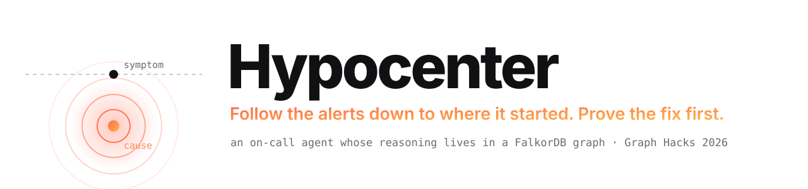
  </picture>
</p>

<p align="center">
  <a href="https://16-4-94-72.sslip.io"></a>
  <a href="docs/judge-check-clean-clone.txt"></a>
  <a href="#reproduce-it"></a>
  <a href="docs/mutants.txt"></a>
  <a href="#proof-at-a-glance"></a>
  <a href="#falkordb-feature-map"></a>
  <a href="#demo-video"></a>
  <a href="https://dev.to/rag2102/hypocenter-the-on-call-agent-that-wont-blame-your-deploy-without-proof-man"></a>
  <a href="LICENSE"></a>
  <br>
  <a href="#context-for-any-agent-mcp"></a>
  <a href="#use-it"></a>
  
  
  
  
  
  <a href="#track-fit"></a>
</p>

<p align="center">
  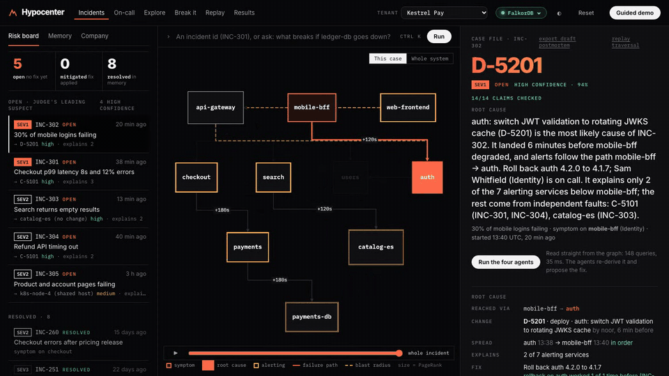
  <br><sub>Recorded from the running app: mobile logins failing, seven services alerting. The four agents stream their steps into the case file, then the rollback is proved on a <code>GRAPH.COPY</code> and waits for a person.</sub>
</p>

<p align="center">
  <a href="https://16-4-94-72.sslip.io"><b>Live demo</b></a> · <a href="#demo-video"><b>Demo video</b></a> · <a href="https://dev.to/rag2102/hypocenter-the-on-call-agent-that-wont-blame-your-deploy-without-proof-man"><b>Blog post</b></a> · <a href="#use-it"><b>Use it</b></a> · <a href="#proof-at-a-glance"><b>Proof</b></a> · <a href="#see-it"><b>Screens</b></a> · <a href="#graph-model"><b>Graph model</b></a> · <a href="#what-the-judges-asked-for"><b>For judges</b></a> · <a href="#contents"><b>Contents</b></a>
</p>

## At a glance

| | |
|---|---|
| **What it is** | An on-call agent whose reasoning lives in a FalkorDB graph: the company (services, calls, owners, deploys, pods, chat), the alerts, and every hypothesis, piece of evidence and handoff the agents produce. |
| **The question it answers** | *What broke, why, and will the fix work?* It follows the alerts down the call graph to the change, service or node where the failure started, argues every suspect with evidence it can cite, and proves the fix on a copy of the graph before a person approves it. |
| **The rule** | A suspect counts only if a path in the graph connects it to the symptom and the alerts climb that path in order. No path, no blame, and no path is not proof of safety either: a service failing with no link the judge could follow is "not proven, check the topology", and a name the graph doesn't have is "not modelled", never "safe". Every verdict goes through <!-- claim:gate.checks -->8<!-- /claim --> named checks before it is called proven. |
| **Proven on real outages** | All 360 failures of the public [RCAEval](https://huggingface.co/datasets/phamquiluan/RCAEval) benchmark, against RCAEval's own baseline code: **<!-- claim:real.ac1 -->0.81<!-- /claim -->** right first (NSigma <!-- claim:real.nsigma -->0.78<!-- /claim -->). On 90 Train Ticket failures kept out of development: **<!-- claim:heldout.ac1 -->0.71<!-- /claim -->**, and NSigma's <!-- claim:heldout.nsigma_ac1 -->0.76<!-- /claim --> is better. We say so. |
| **FalkorDB depth** | The only store. All eight algorithms v4.14.10 ships do work in an investigation, each with a test that changes what it reads and watches the decision move. One graph per company, read through its own read-only database user, `GRAPH.COPY` for every proof and experiment, `GRAPH.RO_QUERY` for every read, vector and full-text indexes for memory. |
| **Try it** | **Live: [16-4-94-72.sslip.io](https://16-4-94-72.sslip.io)** (no sign-in, no key; everyone shares one demo, reset every 6 hours). MCP for any agent: `https://16-4-94-72.sslip.io/mcp`, read-only. Or run it yourself in one command: [Use it](#use-it). |
| **For a judge** | `make judge-check`: build, start, every test, then the product's own checks on scratch graphs, in about two minutes with Docker and no key. [It passes on a fresh clone.](docs/judge-check-clean-clone.txt) |
| **Stack** | FalkorDB v4.14.10 · Python 3.12, FastAPI · vanilla JS, Cytoscape.js, Three.js, no build step · MCP over stdio and HTTP · Claude (`claude-opus-5-5`) optional: without a key the same agents run as a fixed playbook · Docker Compose. |
| **Built for** | Graph Hacks: Context for AI Agents (WeMakeDevs × FalkorDB). Tracks **01** Agents That Act on Connected Data (main) · **02** Agent Memory and Coordination · **03** Company Brain. [Track fit](#track-fit). |

## Use it

```bash
docker compose up -d --build        # FalkorDB + the app; the graphs are built on first start
open http://localhost:8090          # the site; the incident room is /app
make judge-check                    # everything a judge needs to check, ~2 minutes
```

- **Live, nothing to install:** [16-4-94-72.sslip.io](https://16-4-94-72.sslip.io), the incident room at [/app](https://16-4-94-72.sslip.io/app). It runs in public mode: the same app, read-only MCP, webhooks behind a token, rate limits per visitor.
- **In the incident room** (`/app`): pick an incident on the risk board and the verdict is on screen at once, with the evidence gate's eight checks; **Run the four agents** re-derives it step by step. Ask questions in the bar: `what breaks if ledger-db goes down?`, then `who owns it?`, or `why was C-5101 made?`.
- **Before a change ships** (`/preflight`, or `scripts/preflight.sh` in CI): ship, review or hold, with every reason from the graph ([Before it ships](#before-it-ships-the-pre-deploy-check)).
- **From any MCP client:** `claude mcp add hypocenter -- docker compose -f /path/to/repo/docker-compose.yml exec -T app python -m faultline.mcp_server` ([MCP](#context-for-any-agent-mcp)).
- **With Claude driving the agents:** set `ANTHROPIC_API_KEY`; `make live-run` records a transcript. Without a key everything still works.
- **Your own data:** upload an incident JSON or an RCAEval-layout zip as a new company; load a Slack export with `python -m faultline.chat`.

## In short

- **Reasoning you can query.** Not a chat transcript: hypotheses, evidence, citations, causal chains between alerts, agent handoffs and fix proofs are nodes and edges. "Why did this alert fire?" is one query.
- **The graph decides.** The verdict comes from walking the call graph and checking the alerts climb it in order. Claude, when it is used, only chooses which tools to call; every claim it makes is checked against the graph, and the ones the graph can't back are dropped.
- **Proof before approval.** Every fix is first applied to a copy of the graph: which alerts it clears, which it leaves, and what explains the rest. A person approves; then Hypocenter checks the alerts really cleared.
- **A company brain.** Owners and who actually knows a service, the on-call rota, journeys and SLOs, pods on nodes, deploys to commits, the team's chat and the decisions in it, past incidents and other companies' public post-mortems.
- **Proven, or it says why not.** Every verdict goes through eight named checks, each with the query that decided it, and every rival through the same ones. All pass: confirmed. A hole in the case: not confident. No path, or a failure the graph can't link: the graph can't prove this, and it says so.
- **Measured, not claimed.** 360 real failures against published baselines with a held-out set, planted faults with ablations, a scale test at 3,000 services, 28 named breakages each caught by a test, and every number in this README tagged with the file that measured it and checked by `make claims`.

## How it works

<p align="center">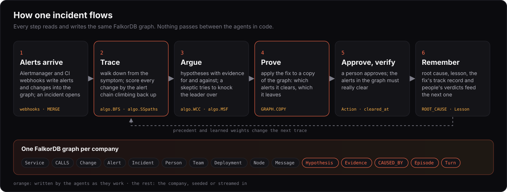</p>

| | What you see | What FalkorDB does |
|---|---|---|
| **1. Trace** | `auth` deploy D-5201, 6 min before mobile logins failed; a flag flip on `users` sits on the same path but is rejected: `users` never alerted | Alert-chain judge over a 5-hop BFS down `CALLS`, a fault simulator per suspect, WCC to split independent faults, the node a pod runs on, the commit inside the deploy |
| **2. Argue** | Five hypotheses: one standing, four rejected, each with the evidence for and against it and what that evidence cites | `(Hypothesis)-[:SUPPORTED_BY \| CONTRADICTED_BY]->(Evidence)-[:CITES]->(Alert \| Change \| Commit \| …)`, and the alerts linked `(Alert)-[:CAUSED_BY]->…->(Change)`: "why did A-9102 fire?" is one query |
| **3. Prove** | "Rolling back D-5201 clears auth and mobile-bff; the pool change and the search cluster below it stay with INC-301 and INC-303" | `GRAPH.COPY`, the causal chain written into the copy, every alert whose `CAUSED_BY` path ends at the fix cleared, the judge asked again on what is left; the copy dropped |
| **4. Verify and remember** | Approve: "as predicted on the graph copy". A decoy fix was shown to clear nothing before, and reopens the incident after | The cleared alerts checked against the prediction; `ROOT_CAUSE`, a `Lesson`, the fix's track record and a person's "not the cause" written back and learned from |

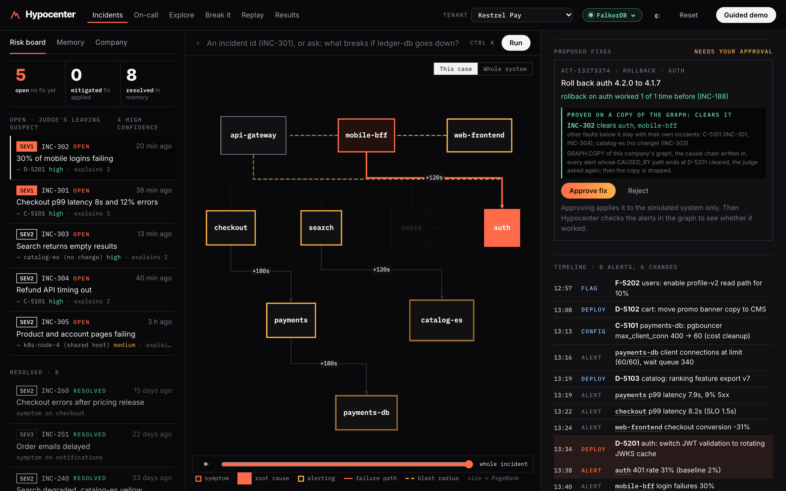

A person approves every fix; nothing outside the simulated world is changed.

## Proof at a glance


Every number links to how it was measured. Where Hypocenter loses, the row says so.

| Claim | Hypocenter | Compared with | Measured by |
|---|---|---|---|
| Finds the cause of real outages | **<!-- claim:real.ac1 -->0.81<!-- /claim -->** <!-- claim:real.ac1_ci -->[0.77–0.85]<!-- /claim --> right service first over all 360 RCAEval failures | NSigma <!-- claim:real.nsigma -->0.78<!-- /claim --> <!-- claim:real.nsigma_ci -->[0.74–0.82]<!-- /claim -->: the 95% intervals overlap, so 360 cases can't separate the two · CIRCA <!-- claim:real.circa -->0.71<!-- /claim --> (on 240) · earliest alert <!-- claim:real.earliest -->0.51<!-- /claim --> · BARO <!-- claim:real.baro -->0.28<!-- /claim --> | RCAEval's own baseline code, run here ([Public data](#public-data-every-rcaeval-case-against-the-published-baselines)) |
| Holds on failures nobody tuned on | **<!-- claim:heldout.ac1 -->0.71<!-- /claim -->** <!-- claim:heldout.ac1_ci -->[0.61–0.79]<!-- /claim --> AC@1, <!-- claim:heldout.avg5 -->0.75<!-- /claim --> Avg@5 on 90 held-out Train Ticket failures | **NSigma is better: <!-- claim:heldout.nsigma -->0.76 / 0.83<!-- /claim -->** (AC@1 <!-- claim:heldout.nsigma_ci -->[0.66–0.83]<!-- /claim -->); BARO <!-- claim:heldout.baro -->0.67 / 0.80<!-- /claim --> | settings frozen before the held-out run ([Results](#results)) |
| No confident wrong blames on real outages | **<!-- claim:real.high_wrong -->0 wrong of 12<!-- /claim -->** high-confidence verdicts on the 360 RCAEval failures; high or medium: <!-- claim:real.confident_right -->241 of 251<!-- /claim --> right first <!-- claim:real.confident_ci -->(0.93–0.98)<!-- /claim --> | low confidence: <!-- claim:real.low_right -->51 of 109<!-- /claim --> right, so "low" means look again | `python -m faultline.compare` ([docs/rcaeval-results.md](docs/rcaeval-results.md)) |
| Ignores the decoys | **<!-- claim:planted.range -->94.5–96.8%<!-- /claim -->** top-1 on held-out seeds of planted faults, each with decoy changes | "blame the most recent change" 50.0% · "the nearest recent change" 10.7% | `python -m faultline.eval` ([Evaluation](#evaluation)) |
| Its confidence means something | when it says **high**, right 99.2–100% of the time on held-out seeds | medium 98.0–99.1% · low 74.6–83.8% | the same eval |
| The graph does the work | **8 of 8** algorithms change a decision when what they read changes; without FalkorDB there is no answer | the decision before the change, on the same graph copy | `tests/test_load_bearing.py` ([The graph does the work](#the-graph-does-the-work)) |
| Depth matters | **5 of 5** open Kestrel incidents right from two hops down | depth 1: 3 of 5, one blamed with high confidence on a victim | `depth_sweep` ([Results page](https://16-4-94-72.sslip.io/results#depth)) |
| The fix is proved first | **5 of 5** fix proofs predict only alerts the seed planted as caused by that fix; the decoy fix clears nothing | approving the decoy reopens the incident | `GRAPH.COPY` proofs, live on the Results page |
| Verdicts are proven, or say why not | **<!-- claim:kestrel.confirmed -->5 of 5<!-- /claim -->** open Kestrel verdicts pass all <!-- claim:gate.checks -->8<!-- /claim --> named checks of the evidence gate | cut auth out of the call graph and the gate answers "the graph can't prove this", with D-5201 not proven rather than ruled out | `tools.evidence_gate`, `tests/test_gate.py` ([The evidence gate](#the-evidence-gate)) |
| Claims are checked | **14 of 14** claims in INC-302's verdict backed by the graph | false claims ("C-5101 changed auth") are caught and dropped | `verify_claims`, tests |
| Agents stay isolated under load | **24** investigations, 8 at a time: 0 cross-run reads, every verdict identical to a run on its own | a single run | `python -m faultline.bench` |
| It holds up at size | a verdict in **<!-- claim:scale.judge_3000 -->73 ms<!-- /claim -->** at 3,000 services (<!-- claim:scale.nodes_3000_k -->211k<!-- /claim --> nodes) | <!-- claim:scale.judge_1000 -->28.5 ms<!-- /claim --> at 1,000 services | `python -m faultline.scale` ([docs/scale.md](docs/scale.md)) |
| The safeguards are real | **<!-- claim:mutants -->28 of 28<!-- /claim -->** named breakages caught by a test | | `make mutants` ([docs/mutants.txt](docs/mutants.txt)) |

<table>
<tr>
<td width="50%">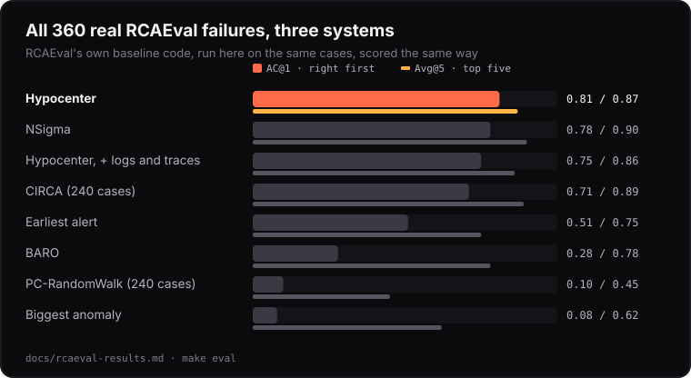</td>
<td width="50%">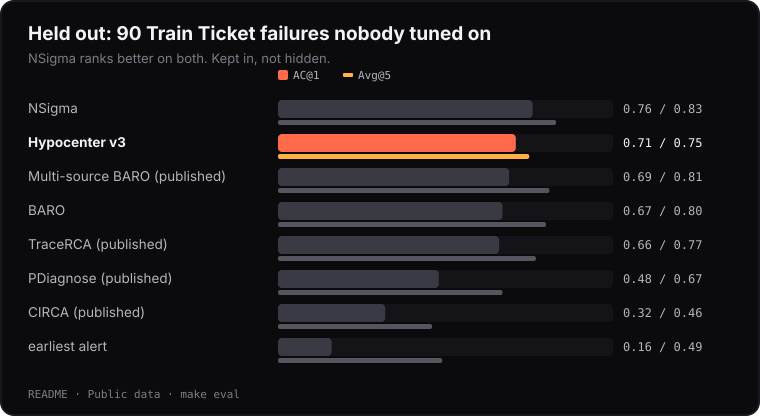</td>
</tr>
<tr>
<td>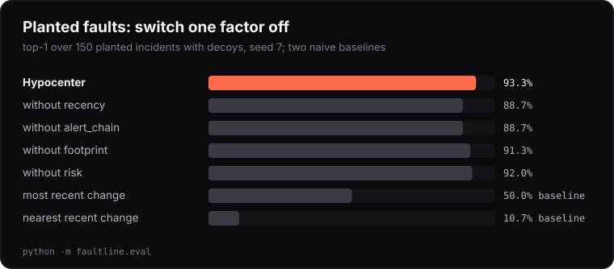</td>
<td>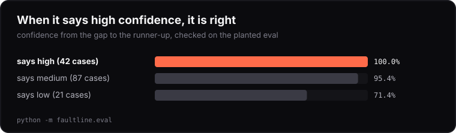</td>
</tr>
<tr>
<td>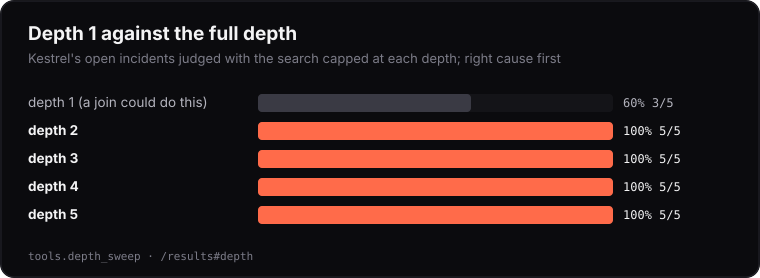</td>
<td>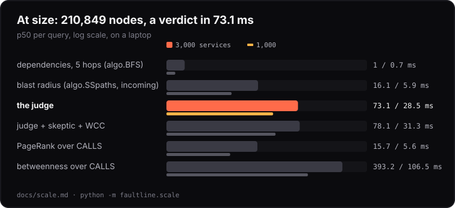</td>
</tr>
</table>

<sub>Intervals are 95% Wilson intervals. Every number in this table and in the two above it is tagged in this file's source with the measurement it comes from; <code>make claims</code> (and a test) fails if one drifts. Every chart is drawn by <code>python -m faultline.charts</code> from the same files the Results page reads (and, for depth, from the graph); a test regenerates them and compares.</sub>

## See it


<table>
<tr>
<td width="50%">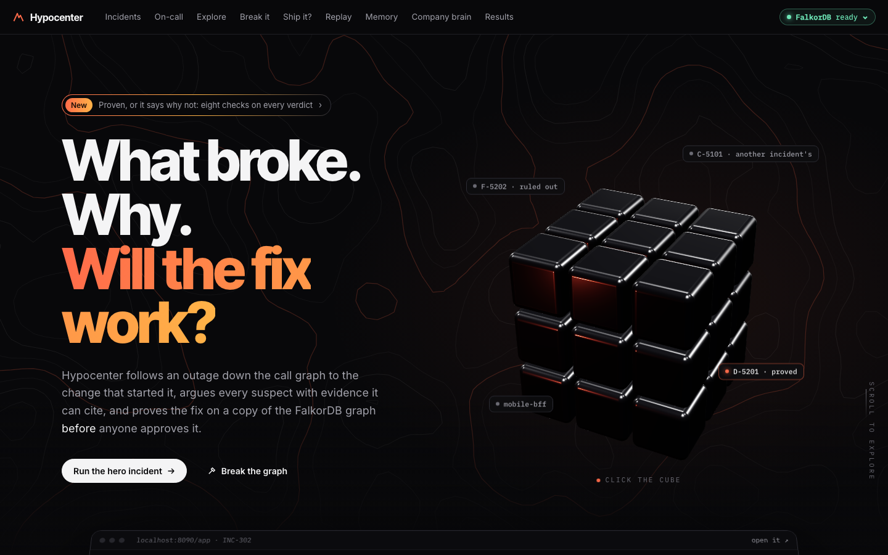<br><sub><b>The site.</b> The graph as a cube you can turn and take apart into its node types, live counts from FalkorDB.</sub></td>
<td width="50%">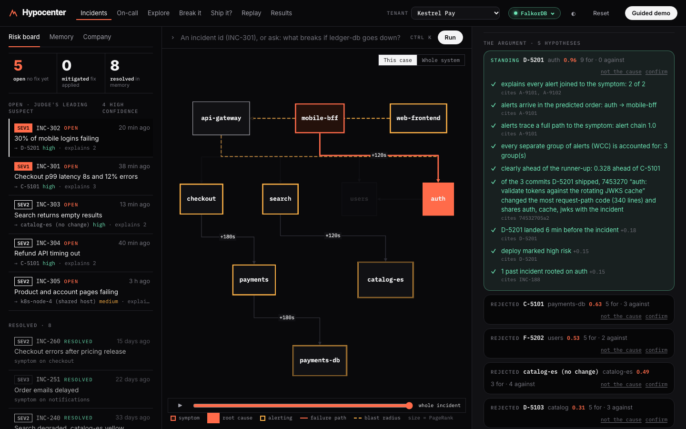<br><sub><b>The argument.</b> INC-302: each suspect a hypothesis with evidence for and against, every piece citing nodes.</sub></td>
</tr>
<tr>
<td>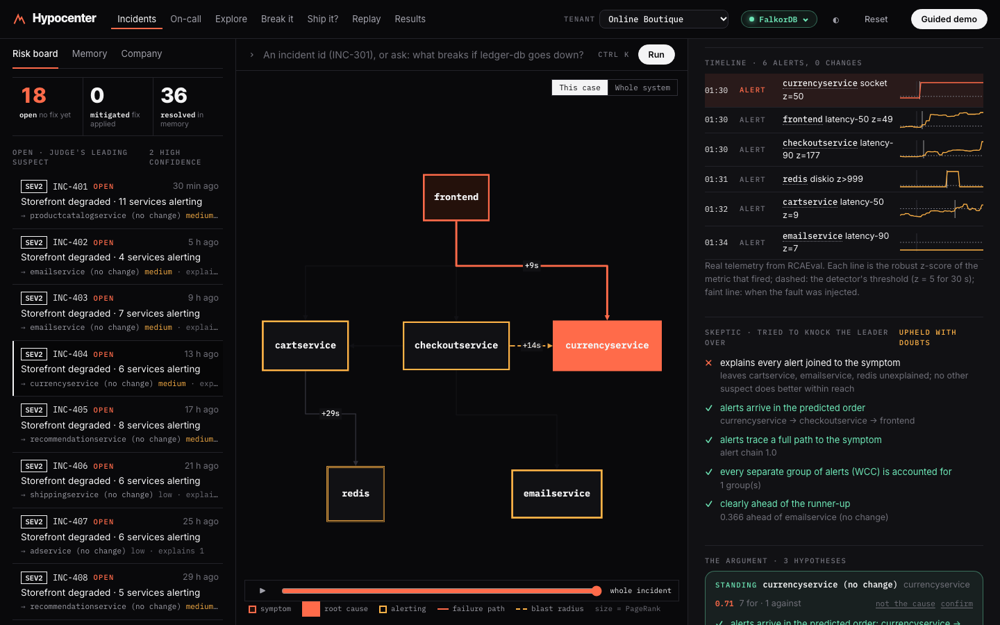<br><sub><b>A real failure.</b> Online Boutique from RCAEval, a CPU fault on currencyservice: the alerts as real metric traces.</sub></td>
<td>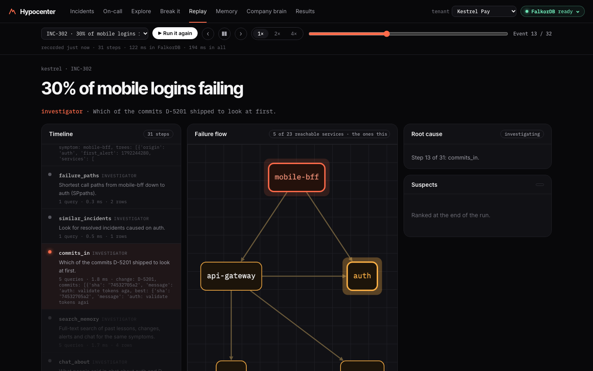<br><sub><b>Replay.</b> The investigation streamed live, then played back step by step; each service lights as it is reached.</sub></td>
</tr>
<tr>
<td>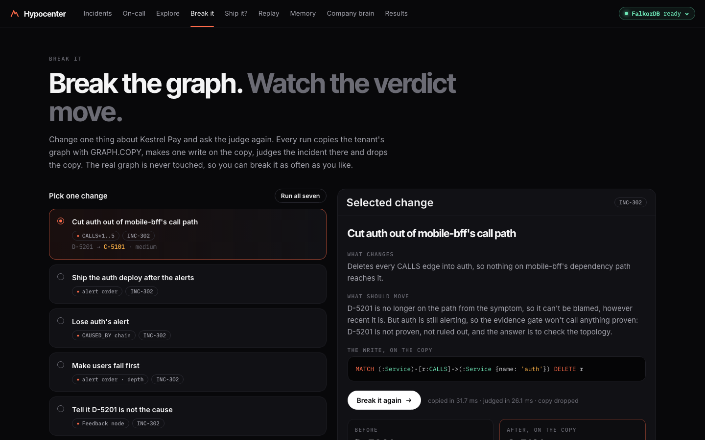<br><sub><b>Break it.</b> One change on a <code>GRAPH.COPY</code>, the judge asked again: cut auth out and D-5201 gives way to C-5101.</sub></td>
<td>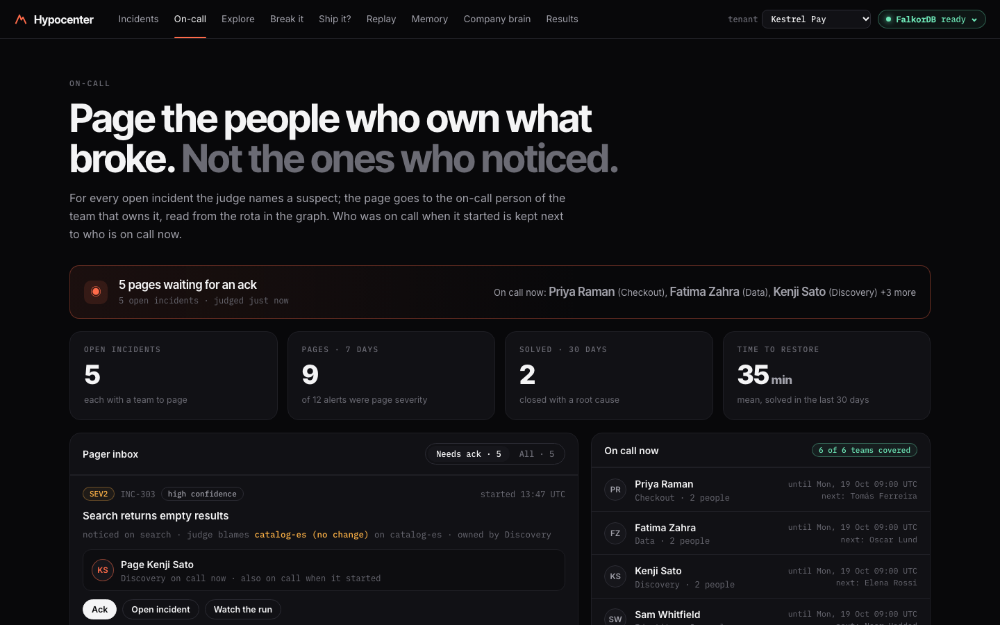<br><sub><b>On-call.</b> Who to page for each open incident, from the rota in the graph; who was on call when it started.</sub></td>
</tr>
<tr>
<td>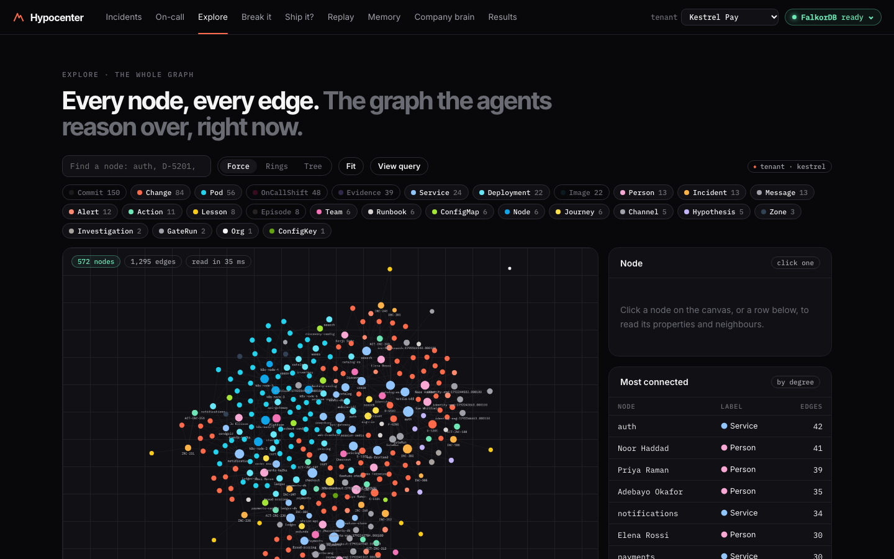<br><sub><b>Explore.</b> Every node and edge the agents reason over, by label, with a node inspector and a query box.</sub></td>
<td>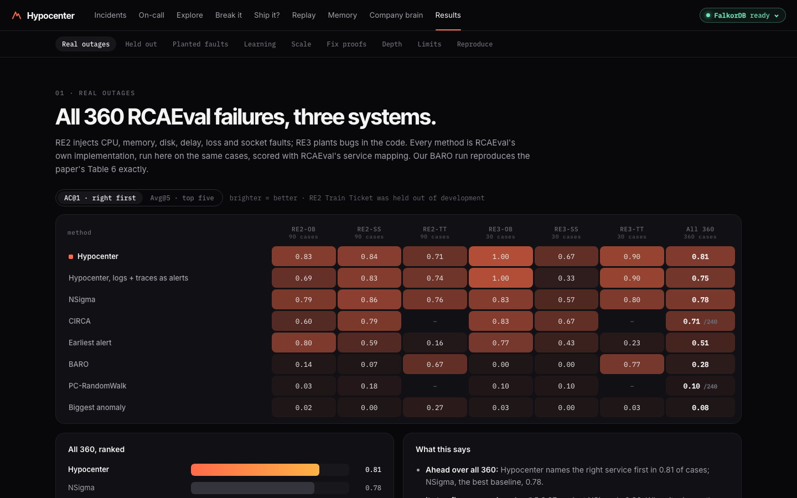<br><sub><b>Results.</b> All 360 RCAEval failures against the baselines, read from the files that publish them.</sub></td>
</tr>
<tr>
<td>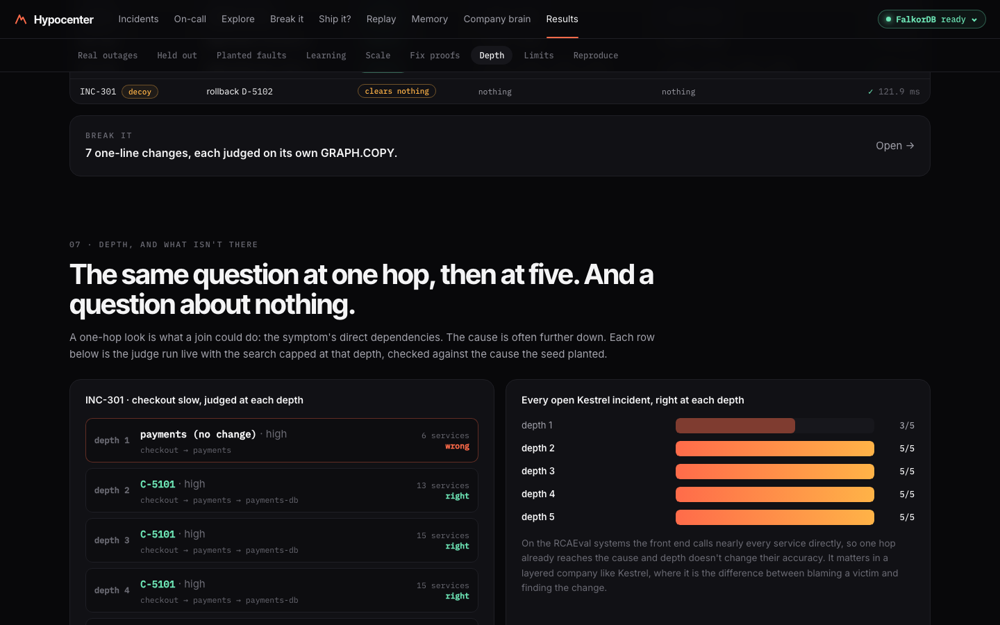<br><sub><b>Depth and unknowns.</b> The same incident at one hop and at five, and a name the graph doesn't have.</sub></td>
<td>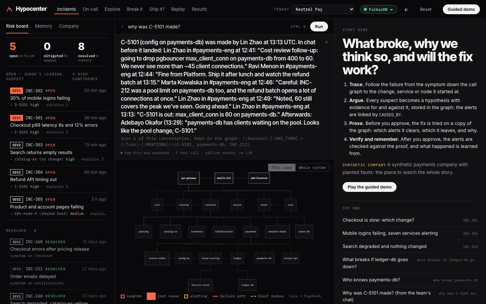<br><sub><b>Company brain.</b> "Why was C-5101 made?": the proposal, the approval and a warning, from the team's chat.</sub></td>
</tr>
<tr>
<td>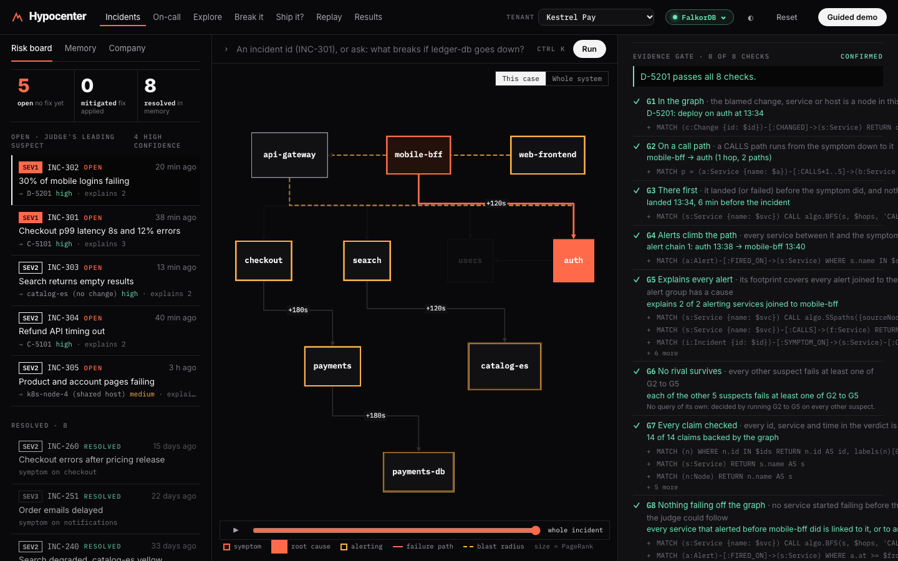<br><sub><b>The evidence gate.</b> INC-302's leader through eight named checks, each with its Cypher; every rival through the same ones.</sub></td>
<td>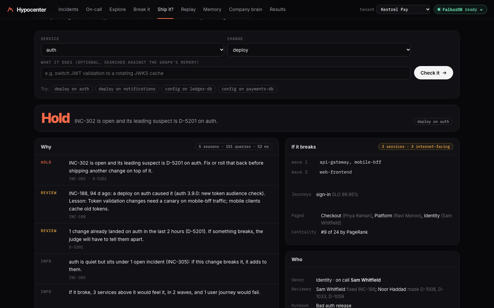<br><sub><b>Ship it?</b> Before a change goes out: a deploy on auth is held, D-5201 on auth is INC-302's suspect.</sub></td>
</tr>
</table>

<p align="center">
  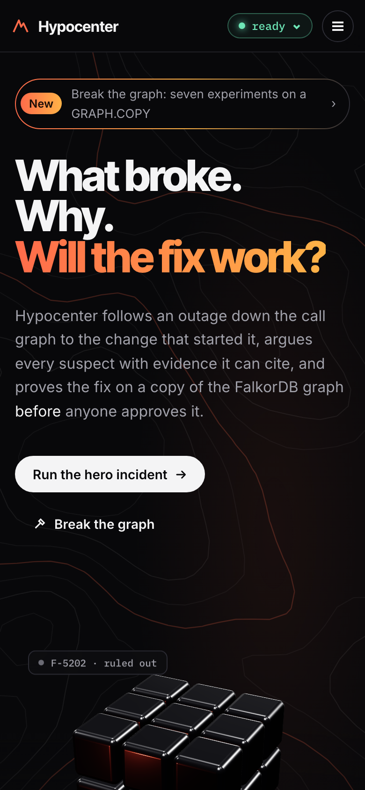
  &nbsp;
  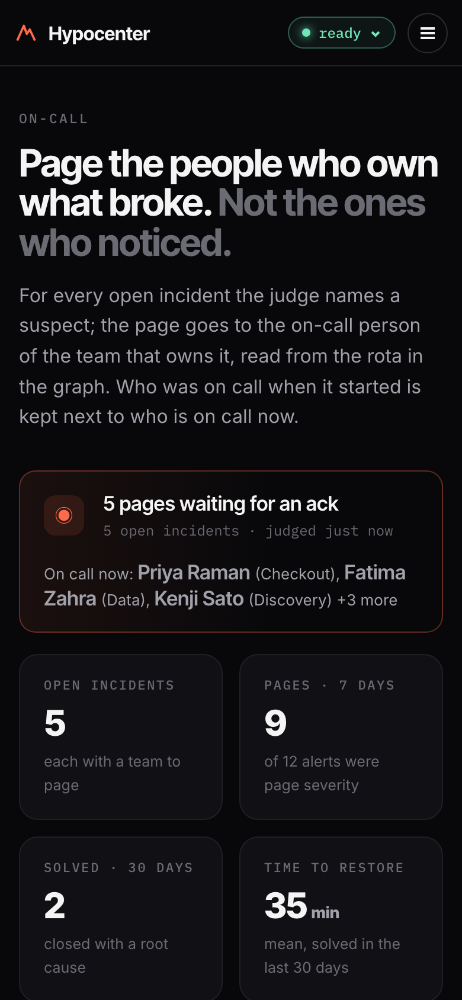
  <br><sub>Every page works at phone width.</sub>
</p>

<sub>Screens are taken from the running app by <code>node demo/gallery.mjs</code>; the GIF by <code>demo/gif.mjs</code>.</sub>

## Demo video


<!-- Replace the line below with the link to the demo video. -->
**The demo video will be linked here.** Until then, the GIF at the top is the app running, and [Use it](#use-it) runs it on your machine in one command.

**Blog post:** [Hypocenter: The On-Call Agent That Won't Blame Your Deploy Without Proof](https://dev.to/rag2102/hypocenter-the-on-call-agent-that-wont-blame-your-deploy-without-proof-man) on DEV, the story behind it in five minutes.

## Contents

- [At a glance](#at-a-glance)
- [Use it](#use-it)
- [In short](#in-short)
- [How it works](#how-it-works)
- [Proof at a glance](#proof-at-a-glance)
- [See it](#see-it)
- [Demo video](#demo-video)
- [What makes it different](#what-makes-it-different)
- [Why FalkorDB, in numbers](#why-falkordb-in-numbers)
- [What the judges asked for](#what-the-judges-asked-for)
- [Track fit](#track-fit)
- [Glossary](#glossary)
- [Reproduce it](#reproduce-it)
- [Why existing approaches fall short](#why-existing-approaches-fall-short)
- [How one incident flows](#how-one-incident-flows)
- [See it work: two incidents](#see-it-work-two-incidents)
- [The evidence checks](#the-evidence-checks)
- [Architecture](#architecture)
- [Graph model](#graph-model)
- [FalkorDB feature map](#falkordb-feature-map)
- [The graph does the work](#the-graph-does-the-work)
- [Query catalogue](#query-catalogue)
- [Results](#results)
- [Evaluation](#evaluation)
- [Public data: every RCAEval case, against the published baselines](#public-data-every-rcaeval-case-against-the-published-baselines)
- [In detail](#in-detail)
- [Memory, company brain and chat](#memory-company-brain-and-chat)
- [On-call](#on-call)
- [Learns from the people who use it](#learns-from-the-people-who-use-it)
- [Agents and actions](#agents-and-actions)
- [Before it ships: the pre-deploy check](#before-it-ships-the-pre-deploy-check)
- [Context for any agent (MCP)](#context-for-any-agent-mcp)
- [Running it in detail](#running-it-in-detail)
- [Safety](#safety)
- [What's real vs synthetic](#whats-real-vs-synthetic)
- [Scope and assumptions](#scope-and-assumptions)
- [What didn't work](#what-didnt-work)
- [AI disclosure](#ai-disclosure)
- [Repo map](#repo-map)
- [License](#license)

## What makes it different


- **The reasoning is a graph, not a transcript.** Hypotheses, the evidence for and against each, what every piece of evidence cites, the causal chain between alerts and the handoffs between agents are all nodes and edges, written as the agents work and queryable afterwards.
- **No path, no blame.** A change is a suspect only if a call path connects it to the symptom, and it leads only if the alerts climb that path in order. A change the failure climbed past is marked down; a service that failed with nothing changed, or a node shared by two services, is an answer too.
- **The fix is proved before anyone approves it**, on a `GRAPH.COPY`, and verified afterwards from which alerts cleared. A wrong fix reopens the incident.
- **Real data, held out.** All 360 RCAEval failures, RCAEval's own baseline code, one system's failures kept out of development until the method was frozen, and the result reported when it loses.
- **The company is in the graph too**: owners and experts, the rota, journeys and SLOs, pods on nodes, deploys to commits, the team's chat and the decisions in it.
- **Agents coordinate only through the graph.** Four agents, no shared memory in code: each writes an `Episode`, the next reads it back.

## Why FalkorDB, in numbers


| | |
|---|---|
| **<!-- claim:casefile.queries -->188 queries<!-- /claim --> in about 35 ms** | everything behind INC-302's case file (judge, skeptic, alert groups, impact, experts, memory, the argument, the evidence gate's eight checks), read-only, before any agent runs |
| **<!-- claim:scale.judge_3000 -->73 ms<!-- /claim -->** | the judge's verdict on a 3,000-service company of <!-- claim:scale.nodes_3000 -->211,000<!-- /claim --> nodes and <!-- claim:scale.edges_3000 -->252,000<!-- /claim --> edges (p50, a laptop) |
| **<!-- claim:scale.bfs_3000 -->1 ms<!-- /claim -->** | a five-hop `algo.BFS` down the call graph at that size |
| **10–100 ms** | a `GRAPH.COPY` of Kestrel for a fix proof or a Break-it experiment, then the judge again on the copy in about 30 ms |
| **8 of 8** | algorithms v4.14.10 ships, each feeding a decision ([feature map](#falkordb-feature-map)) |
| **6 + 1 per upload** | separate graphs on one instance: five companies, the public post-mortem knowledge graph, one per uploaded incident |
| **0** | writes through the read path: every read goes through `GRAPH.RO_QUERY`, so the database itself refuses them |
| **1 user per tenant** | a request for a company reads as that company's own FalkorDB ACL user, allowed `GRAPH.RO_QUERY` on its one graph and nothing else: a write, or another tenant's graph, is refused by the database |

## What the judges asked for


The rules page, the challenge text and the organisers' day-1 post ("How to Build an Agent That Reasons Over a Graph", section "What Judges Are Looking For") say what is judged. Each line is quoted as published, then answered with something you can run.

| Judging line | What Hypocenter does | Check it |
|---|---|---|
| "The graph has to shape what the agent does, not sit on the side." (challenge) | The verdict is a graph walk: every suspect comes from a 5-hop `algo.BFS` down `CALLS` from the symptom and is scored by whether the alerts climb that path in order. Switching the alert chain off drops planted-fault accuracy from 93.3% to 88.7% (deep faults: 100% → 83.3%); "blame the nearest recent change" gets 10.7%. | `python -m faultline.eval` ([Evaluation](#evaluation)) |
| "If the product still works once FalkorDB is taken out, the graph is decoration rather than the thing the product runs on." (rule 3) | There is no other store: without FalkorDB an investigation fails on the connection rather than guessing. Every agent tool is a Cypher query or a FalkorDB algorithm, and for each algorithm a test changes what it reads on a graph copy and the decision changes with it. | [The graph does the work](#the-graph-does-the-work) |
| "Run the same question twice. Once with a depth of one … Then with a depth of four" (organisers' post) | `depth_sweep` judges one incident with the search capped at 1 to 5 hops. INC-301 at depth 1 sees 6 services and blames `payments`, with high confidence; it only alerted. From depth 2 it finds C-5101, the pool change on `payments-db`. Over Kestrel's open incidents: 3 of 5 right at depth 1, 5 of 5 from depth 2. On the RCAEval systems the front end calls nearly everything directly, so depth doesn't change their accuracy; we say so. | `GET /api/kestrel/incidents/INC-301/depth`, the [Results page](https://16-4-94-72.sslip.io/results#depth), the `depth_sweep` MCP tool |
| "ask the agent something that is not in the graph and let it say so" (organisers' post) | "What breaks if billing-svc goes down?" answers "Nothing in the graph is called billing-svc. That means it isn't modelled, not that it is safe", with the lookup's Cypher. A service nothing calls is reported as an entry point or as unknown, never as safe. An empty traversal isn't read as safe either: a service that failed before the symptom with no `CALLS` link to it is "not proven, check the topology" (the evidence gate's G8), not "ruled out". | Ask bar in the app, `find_named` MCP tool, [the evidence gate](#the-evidence-gate) |
| "Show the path behind an answer" (challenge) | `MATCH p = (:Alert {id: 'A-9102'})-[:CAUSED_BY*]->(root) RETURN p` returns A-9102 on mobile-bff ← A-9101 on auth ← D-5201. Every step in the case file shows its Cypher. | [In detail, 9](#in-detail) |
| "one instance can hold thousands of isolated graphs, so each user, agent, or tenant gets its own" (about the sponsor) | One graph per company (five, plus one per upload); fix proofs, Break-it experiments and the load test each run on a `GRAPH.COPY` that is dropped afterwards. 40 runs, 8 at a time: no run read another run's handoffs. A request for a company reads as that company's own read-only database user, so the database, not the code, keeps tenants apart. | `python -m faultline.bench`, `tests/test_acl.py` |
| "Traversals are fast enough to run on every step of an agent loop" (about the sponsor) | At 3,000 services (<!-- claim:scale.nodes_3000 -->211,000<!-- /claim --> nodes) the judge answers in <!-- claim:scale.judge_3000 -->73 ms<!-- /claim --> (p50) and a 5-hop dependency walk in about a millisecond. | [docs/scale.md](docs/scale.md) |

Rule 10 asks for a public repository, a README with setup and the graph data model, the Cypher the product depends on, a demo video, a deployment or local setup, and the track: [Run it](#use-it) (and `make judge-check`), [How the graph is used](#the-evidence-checks), [the judge's queries](#the-evidence-checks), and [Tracks](#track-fit). Rule 11: [AI use](#ai-disclosure).

## Track fit


Each track's key-focus bullets, as the hackathon page lists them, with where Hypocenter answers them. Where it doesn't, the row says so.

| Track bullet | In Hypocenter | Code | Evidence |
|---|---|---|---|
| **T1** Multi-hop reasoning | Suspects up to 5 `CALLS` hops below the symptom, scored by the alert chain along each path | `faultline/tools.py` `rank_suspects`, `depth_sweep` | depth 1: 3/5 right; depth 2+: 5/5 |
| **T1** Graph queries and algorithms as agent tools | All eight algorithms FalkorDB v4.14.10 ships (BFS, SSpaths, SPpaths, WCC, MSF, betweenness, label propagation, PageRank), each doing work in an investigation and each a tool an agent can call | `faultline/tools.py`, `faultline/agent.py` | [the algorithm table](#falkordb-feature-map) |
| **T1** Tool selection through MCP | The same tools over MCP (stdio, and read-only HTTP on a public server); no approve tool | `faultline/mcp_server.py` | [MCP](#context-for-any-agent-mcp) |
| **T1** Actions based on what the graph shows | A fix is proposed, proved on a `GRAPH.COPY`, approved by a person, then verified from which alerts cleared. Before a change ships, the pre-deploy check says ship, review or hold from the same graph | `faultline/proof.py`, `tools.verify_fix`, `faultline/preflight.py` | 5 of 5 fix proofs hold; the decoy clears nothing; a deploy on auth during INC-302 is held |
| **T1** Explainable results | Hypotheses with evidence for and against, each citing nodes; the `CAUSED_BY` chain; every claim checked against the graph; the evidence gate's eight named checks, each with its query | `faultline/reasoning.py`, `tools.verify_claims`, `tools.evidence_gate` | INC-302: 15 of 15 claims checked |
| **T2** Episodic, semantic, procedural memory | Episodic: resolved incidents, `Lesson`s, past `Investigation`s. Semantic: owners, runbooks, journeys. Procedural: each fix's track record per service | `faultline/tools.py` | deleting memory lowers the same change's score (a test) |
| **T2** Persistent conversation history | Every question in the Ask bar and its answer is a `Turn` in a `Session`, linked to the turn before and to what it was about, and read back before the next question: "who owns it?" after "what breaks if ledger-db goes down?" means ledger-db. Investigations and agent handoffs are stored too (`Investigation`, `Episode`) | `tools.record_turn`, `tools.conversation`, `agent.ask` | `GET /api/{t}/sessions/{id}`; tests |
| **T2** Shared state and handoffs between agents | Four agents pass nothing in code: each writes an `Episode`, the next reads it (`READ` edge) | `faultline/agent.py` | investigations resume from the graph |
| **T2** High-concurrency reads and writes | Many investigations at once on a graph copy, isolation and consistency checked; retries when FalkorDB is busy | `faultline/bench.py` | 40 runs, 8 at a time: ~80 runs/s, 0 crossed handoffs, identical verdicts |
| **T2** Separate memory per user or tenant | One graph per company, read through its own read-only FalkorDB user; learned weights per company | `faultline/db.py`, `faultline/learn.py` | the database refuses another tenant's graph (a test) |
| **T3** Knowledge from docs, tickets, and chats in one graph | Chat channels, messages, threads and what each message mentions (from a Slack export; Kestrel's chat is synthetic), runbooks, lessons, incidents, commit messages, CODEOWNERS and public post-mortems sit beside the topology. Memory search covers chat | `faultline/chat.py`, `faultline/owners.py`, `faultline/delivery.py` | the investigator reads the chat around the incident |
| **T3** Who owns what, and who knows what | Owners and on-call rota; experts ranked by the fixes they approved and the changes they made | `tools.who_owns`, `tools.experts`, `faultline/site.py` | INC-302 pages Identity's Sam Whitfield (a test) |
| **T3** Tracing decisions back to their source | `decision_trail`: a change, who made it, the chat discussion that led to it (with its replies), the commits it shipped, what was said once it landed and any revert. Each fix links to who approved it, each verdict to the evidence it cites | `tools.decision_trail`, `faultline/reasoning.py` | "why was C-5101 made?": Lin's proposal, Ravi's OK and Marta's INC-212 warning, before it landed |
| **T3** Keeping knowledge current as things change | Alertmanager and CI webhooks write alerts and changes as they happen; each company's judge is refitted on its solved incidents | `faultline/ingest.py`, `faultline/learn.py` | `demo/fire.sh` plays a live incident in |
| **T3** Answers with clear sources | Each answer step shows its Cypher; a name the graph doesn't have is answered as not modelled | `faultline/agent.py` `ask_offline`, `tools.find_named` | [Results: depth and unknowns](https://16-4-94-72.sslip.io/results#depth) |

The Python package is still called `faultline` (the project's working name); everything a user sees says Hypocenter.

## Glossary


| Term | Meaning here |
|---|---|
| **Symptom** | the service where an incident was noticed (`(:Incident)-[:SYMPTOM_ON]->(:Service)`) |
| **Alert chain** | whether the alerts climb the call path from a suspect up to the symptom, deepest first; the judge's main factor |
| **Footprint** | the fault simulator's answer to "if this broke, which services would alert, and in what order?", compared with what did |
| **Alert cone** | the alerting services joined to the symptom through other alerting services |
| **Judge** | the deterministic scorer (`tools.rank_suspects`): every change on the symptom's dependency path, plus alerting services with no change |
| **Skeptic** | the agent that tries to knock the leader over: what it leaves unexplained, alert order, timing, margin, alert groups |
| **Confidence** | from the gap to the runner-up, not the raw score |
| **Hypothesis / Evidence** | a suspect and what speaks for and against it, written to the graph; evidence `CITES` alerts, changes, commits, incidents |
| **Causal chain** | `(:Alert)-[:CAUSED_BY {lag_s}]->(:Alert)…->(:Change)`: how the failure travelled |
| **Proof** | a fix applied to a `GRAPH.COPY`: the alerts it clears, the ones it leaves |
| **Evidence gate** | eight named checks (G1 to G8) a leader must pass before it is called proven; the verdict is confirmed, not confident, or "the graph can't prove this" |
| **Not proven** | a change or service the graph can't link to the symptom but can't rule out either, because it was failing first: a question for the topology |
| **Pre-deploy check** | the graph read before a change ships: ship, review or hold, with each reason |
| **Depth sweep** | the same incident judged with the search capped at 1 to 5 hops |
| **Spread tree** | the minimum spanning forest of the alerting services weighted by alert timing (`algo.MSF`) |
| **Decision trail** | a change, who made it, the chat that led to it, what was said after |
| **Tenant** | one company, one FalkorDB graph |
| **AC@1 / Avg@5** | right cause first; the mean of AC@1 to AC@5, RCAEval's scores |
| **Held out** | cases never looked at while building the method; RE2 Train Ticket here |

## Reproduce it


| Command | What it checks | Time |
|---|---|---|
| `make judge-check` | build, start, every test, then the product on scratch graphs: verdicts, depth, unknowns, fix proofs, the evidence gate, the pre-deploy check, the read-only user per tenant, the README's numbers, Break it, the planted eval, isolation | ~2 min |
| `docker compose run --rm app pytest -q` | the <!-- claim:tests -->242<!-- /claim --> tests, against a real FalkorDB on separate test graphs | ~1 min |
| `make mutants` | 28 safeguards broken one at a time on a scratch copy; a test must catch each | ~2 min |
| CI ([.github/workflows/ci.yml](.github/workflows/ci.yml), GitHub Actions) | on every push: the tests against a real FalkorDB, then `make claims` | ~3 min |
| `make claims` | every number tagged in this README against the file that measured it (`faultline/claims.py`; the live ones run in `tests/test_claims.py`) | seconds |
| `docker compose run --rm app python -m faultline.eval --n 400 --seed 3` | planted faults with decoys, ablations and baselines (seeds 3, 11, 42 are held out) | seconds |
| `make eval` | every RCAEval number: downloads ~3.3 GB, extracts signals, runs Hypocenter and RCAEval's baselines, writes `docs/rcaeval-results.md` | long, once |
| `make eval-quick` | the same with the data already there | ~10 min |
| `docker compose run --rm app python -W ignore -m faultline.scale --services 3000` | the scale benchmark ([docs/scale.md](docs/scale.md)) | minutes |
| `python -m faultline.schema` · `python -m faultline.charts` | regenerate the graph model and the charts (tests fail if they drift) | seconds |
| `ANTHROPIC_API_KEY=… make live-run` | the four agents played by Claude on INC-302, written to `docs/live-run-INC-302.md` | ~1 min, spends tokens |

## Why existing approaches fall short


Measured on the same cases, not asserted:

- **"Blame the latest deploy"** gets the planted cause first in 50.0% of incidents, and never when nothing changed or a node failed (0% on those kinds). **"Blame the nearest recent change"** gets 10.7%: closeness isn't causation.
- **"The service that alerted first"** is right in 0.51 of the 360 real failures and 0.16 of the held-out Train Ticket ones: the first alert is often a victim.
- **Metric-only ranking** (BARO, NSigma, CIRCA, RandomWalk) can be strong at naming a service: NSigma beats Hypocenter on held-out Train Ticket. But it stops at a service. It doesn't say which change, why, whether two incidents share a cause, who to page, or what a fix would clear, because it has no model of the company to say it with.
- **A model reading dashboards** has nothing to check its story against. Here the model only chooses which tools to call; the verdict comes from the graph, and every claim it makes is looked up there.

## How one incident flows


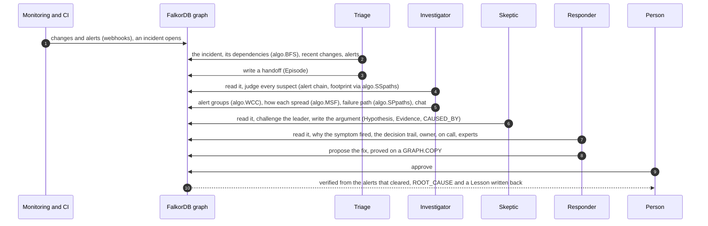

Every step is a tool call with its Cypher, streamed to the case file as it happens and kept for Replay. Each agent sees only its own tools; nothing passes between them except through the graph.

## See it work: two incidents


**A real one: Online Boutique, INC-404.** RCAEval injected a CPU fault into `currencyservice`. Six services alerted. Nothing was deployed, so no change can explain it; the judge lets alerting services with no change compete, finds `currencyservice` alerted first and that the alerts climb `currencyservice → checkoutservice → frontend` in order, and names it: an infrastructure failure, page its owners (from Online Boutique's own CODEOWNERS). That is RCAEval's answer. It explains three of the six alerting services; the alerts on `redis` are left as an independent fault, not forced into the story. ([screen](docs/media/screens/03-real-failure.png))

**A layered one: Kestrel, INC-301 and INC-302.** Checkout is slow. A `cart` deploy is one hop away and newer than anything else, but nothing below it alerted, so it scores 0.27. Two hops down, a connection-pool change on `payments-db` (C-5101) has `payments-db`, `payments` and `checkout` alerting in that order above it: 0.94. The same change explains INC-304, opened by another team, so one fix covers both. Twenty minutes later mobile logins fail with seven services alerting: WCC splits them into three problems, the `auth` deploy D-5201 explains two, and the other two groups are named as INC-301's pool change and INC-303's search cluster. The rollback is proved on a graph copy (it clears `auth` and `mobile-bff`, nothing else) before anyone approves it.

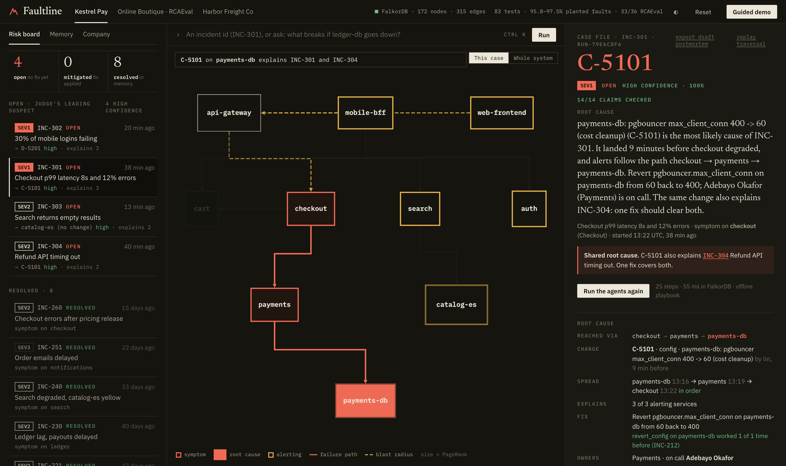

### Five incidents, five kinds of answer


| Incident | What the graph shows | Verdict |
|---|---|---|
| **INC-301** Checkout p99 8s | A pgbouncer limit cut from 400 to 60 on `payments-db`, two hops below `checkout`. `payments` and `payments-db` both alerted after it. A deploy to `cart` was closer and more recent, but nothing on its path alerted. INC-212 (61 days ago) was the same kind of change on the same database. | `C-5101`, revert the config. High confidence. |
| **INC-302** 30% of mobile logins failing | An `auth` deploy one hop below `mobile-bff`, 6 minutes before, with a 401 spike on `auth`. A flag flip on `users` sits on the same path but `users` never alerted. INC-188 was an `auth` token-validation deploy too. Five other services below `mobile-bff` are alerting, but not through `auth`. | `D-5201`, roll back to 4.1.7. The other alerts belong to two **independent faults**: C-5101 (INC-301, INC-304) and `catalog-es` (INC-303). |
| **INC-303** Search returns nothing | Nothing changed on `search`'s path. `catalog-es` went RED two minutes before `search` alerted. INC-240 was a node failure on the same cluster. | **No change caused this.** Page Discovery's on-call for `catalog-es`. |
| **INC-304** Refund API timing out | Opened separately by the Payments team. The same pool change sits one hop below `payments`, with `payments-db` alerting. | **Same root cause as INC-301.** One revert, proposed once, covers both. |
| **INC-305** Product and account pages failing | Nothing changed. `catalog` and `users` both failed on their own, a minute apart; neither calls the other, and the only thing they share is `k8s-node-4` (zone-b). | **A failing host**: cordon and drain `k8s-node-4`, page Platform. The causal chain ends at the `Node`. Without placement in the graph the same alerts read as two independent faults. |

"No change on the path" is an answer, not a failure: in a graph, the absence of a path is evidence.

## The evidence checks

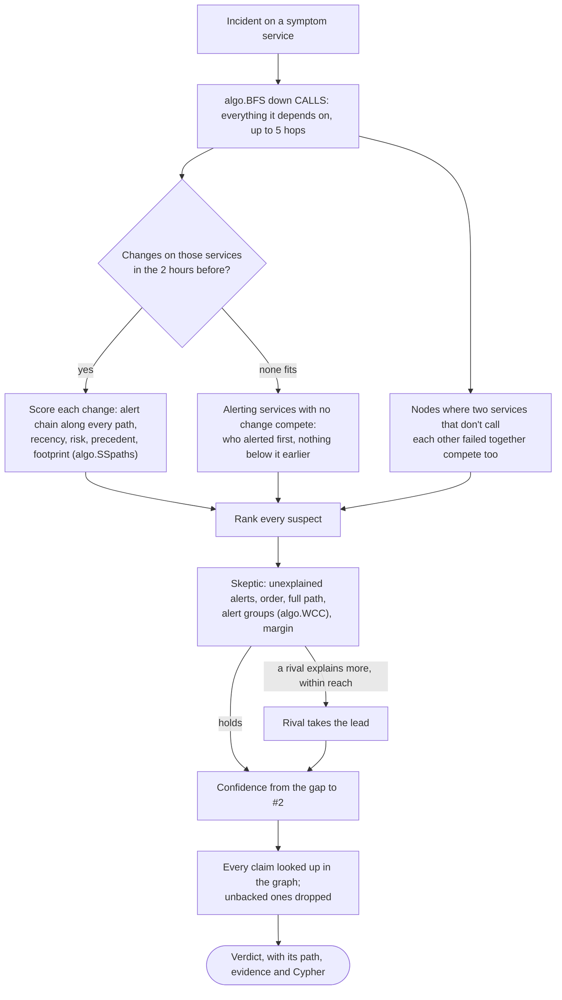


What a verdict has to get through before it is shown, in order:

| Check | What it asks | Where |
|---|---|---|
| **On the path** | is there a `CALLS` path from the symptom down to the suspect? No path, not a suspect (and a name the graph doesn't have is "not modelled") | `tools.dependencies` (`algo.BFS`), `tools.paths_between` |
| **In the window** | did the change land in the two hours before the incident? | `tools.changes_near` |
| **Alert chain** | did every service on the path alert after the change, deepest first? Out of order keeps 70%; a change the failure climbed past is halved | `tools._alert_chain`, `tools._from_below` |
| **Footprint** | if this broke, which services would alert, in what order, and did they? | `tools._footprint` (`algo.SSpaths`) |
| **Separate problems** | are there alert groups the leader can't explain? They become independent faults, not part of its story | `tools.alert_clusters` (`algo.WCC`) |
| **Skeptic** | does it explain every alert joined to the symptom, in the right order, along a full path, clearly ahead of the runner-up? A rival that explains more within reach takes over | `tools.skeptic_review` |
| **Confidence** | how far ahead is it? | `tools.confidence_from` |
| **Claims** | does every id, service and time in the verdict exist, and does each claim say what the graph says? Unbacked claims are dropped | `tools.verify_claims` |
| **Proof** | applied to a graph copy, what does the fix clear and leave? | `proof.preview_fix` (`GRAPH.COPY`) |
| **Verification** | after approval, did the alerts really clear? If not, the incident reopens | `tools.verify_fix` |

### The evidence gate

The checks above decide the ranking. The gate then asks of the leader, by name, whether it is **proven**, and shows each answer with the Cypher that decided it (in the case file, over MCP as `evidence_gate`, and at `GET /api/{tenant}/incidents/{id}/gate`):

| Check | Asks | Decided by |
|---|---|---|
| **G1** In the graph | is the blamed change, service or host a node in this company's graph? | a lookup of the `Change` and the service it `CHANGED` |
| **G2** On a call path | does a `CALLS` path run from the symptom down to it? | `tools.paths_between` (`CALLS*1..5`) |
| **G3** There first | did it land (or fail) before the symptom, with nothing below it failing earlier? | the change time, and `algo.BFS` under it for anything alerting sooner |
| **G4** Alerts climb the path | did every service between it and the symptom alert after it, deepest first? | the alerts on its path, in order |
| **G5** Explains every alert | does its footprint cover every alert joined to the symptom, and does every separate alert group have a cause? | `algo.SSpaths` backwards from it, `algo.WCC` over the alerts |
| **G6** No rival survives | does every other suspect fail at least one of G2 to G5? | the same checks, run on every suspect (the competitor sweep) |
| **G7** Every claim checked | is every id, service and time in the verdict backed by the graph? | `tools.verify_claims` |
| **G8** Nothing failing off the graph | did any service start failing before the symptom with no `CALLS` link the judge could follow? | the alerts in the window off the symptom's paths, less what another open incident accounts for |

All eight pass: **confirmed**. G1, G2 or G8 fails: **the graph can't prove this**. Any other fails: the leader stands, **not confident**. Every one of Kestrel's open verdicts is confirmed. Cut every `CALLS` edge into `auth` on a copy (the first Break-it experiment) and the judge's leader becomes C-5101, but the gate refuses it: *auth started alerting 2 min before mobile-bff did, and the graph has no CALLS path between them: not ruled out, not proven. Check the topology.* D-5201 moves from the suspects to **not proven**, never to "ruled out", because an empty traversal means the graph doesn't know, not that the change is safe. Each investigation keeps its run: `(:Investigation)-[:GATED]->(:GateRun)-[:TESTED {status, failed}]->(:Change)` for the leader, every rival, every change ruled out and every failure it couldn't link.

### The judge, step by step


```
(:Person)-[:MEMBER_OF]->(:Team)<-[:OWNED_BY]-(:Service)-[:CALLS]->(:Service)
(:Person)-[:MADE]->(:Change {deploy|config|flag})-[:CHANGED]->(:Service)
(:Alert)-[:FIRED_ON]->(:Service)
(:Incident)-[:SYMPTOM_ON]->(:Service)
(:Incident)-[:ROOT_CAUSE]->(:Change)   (:Incident)-[:RESOLVED_BY]->(:Action)   (:Incident)-[:TAUGHT]->(:Lesson)
(:Action)-[:FOR]->(:Incident)   # one action can cover several incidents
(:Action)-[:TARGETS]->(:Service)   (:Action)-[:REVERTS]->(:Change)
(:Investigation)-[:INVESTIGATED]->(:Incident)   (:Investigation)-[:BLAMED]->(:Change)
(:Episode {role})-[:ABOUT]->(:Incident)   (:Episode)-[:READ]->(:Episode)   # agent handoffs
(:Incident)-[:SUSPECTED_CAUSE {rank, score, coverage}]->(:Change|:Service)
(:Incident)-[:SIMILAR_TO {score, reason}]->(:Incident)
(:Runbook {steps})-[:FOR_SERVICE]->(:Service)
(:Incident)-[:HAS_HYPOTHESIS]->(:Hypothesis {rank, score, status})-[:BLAMES]->(:Change|:Service)
(:Hypothesis)-[:SUPPORTED_BY|CONTRADICTED_BY]->(:Evidence {kind, text, weight})-[:CITES]->(:Alert|:Change|:Incident|:Service)
(:Alert)-[:CAUSED_BY {incident, lag_s, confidence, direct, via}]->(:Alert|:Change|:Service)   # the causal chain
(:Service)-[:EXPOSES]->(:Operation {rps, p50_ms, p99_ms, err})-[:CALLS {rps, p50_ms, p99_ms, err}]->(:Operation)
(:Alert {strength})-[:ON_OPERATION {p90_before_ms, p90_after_ms, ratio}]->(:Operation)   # the endpoint that slowed
(:LogPattern {template, new})-[:LOGGED_BY]->(:Service)   (:LogPattern)-[:SEEN_IN {count}]->(:Incident)
(:Service)-[:DEPLOYED_AS]->(:Deployment {replicas, cpu_limit, mem_limit_mi, probe})-[:RUNS_IMAGE]->(:Image {repo, tag})
(:Deployment)-[:READS {value}]->(:ConfigKey)<-[:SETS]-(:Change)   (:Deployment)-[:USES_CONFIG|USES_SECRET]->(:ConfigMap|:Secret)
(:Deployment)-[:HAS_POD]->(:Pod)-[:ON_NODE]->(:Node)-[:IN_ZONE]->(:Zone)   (:Node)-[:OWNED_BY]->(:Team)
(:Change {kind: 'deploy'})-[:SHIPS]->(:Commit {sha, message, code_lines})-[:TOUCHED]->(:Service)   (:Person)-[:AUTHORED]->(:Commit)
(:Journey {slo, rps})-[:USES]->(:Service)   (:Journey)-[:STARTS_AT]->(:Operation)
(:Person)-[:ON_SHIFT]->(:OnCallShift {from, to})-[:COVERS]->(:Team)
(:Action {predicted_clear, preview})   # the fix as proved on a GRAPH.COPY before approval (faultline/proof.py)
(:Feedback {verdict, by, note})-[:ABOUT]->(:Incident)   (:Model {kind, weights, enabled, evaluation})   # learned from outcomes
(:Session)-[:HAS_TURN]->(:Turn {question, answer, subject})-[:MENTIONS]->(:Service|:Incident|:Change)   (:Turn)-[:FOLLOWS]->(:Turn)
(:Message {at, text})-[:IN_CHANNEL]->(:Channel)   (:Message)-[:POSTED_BY]->(:Person)   (:Message)-[:REPLY_TO]->(:Message)   (:Message)-[:MENTIONS]->(:Service|:Change|:Incident|:Node)
(:Version {tag})-[:INCLUDES]->(:Commit)-[:MENTIONS]->(:Service)   (:Version)-[:CHANGED {files, additions}]->(:Service)   (:Image)-[:BUILT_FROM]->(:Version)
```

The judge (`faultline/tools.py`, `rank_suspects`) does the multi-hop work:

1. `MATCH (s:Service {name: $symptom}) CALL algo.BFS(s, 5, 'CALLS')`: everything the symptom depends on; the BFS tree's levels are the hop counts.
2. Every deploy, config and flag change on those services in the two hours before the incident. Changes elsewhere are listed as ruled out, with the reason.
3. For each suspect, every call path from the symptom down to it. The **alert chain** is 1.0 only if every service on the path alerted after the change, deepest first. Out of order keeps 70%; a silent cause under a fully alerting path keeps 60%; a change the failure was already climbing past (something below it alerted first) is halved.
4. **Footprint** (the fault simulator): the services that call the suspect, transitively, are where its failure can show. Of the alerting services joined to the symptom through other alerting services (the symptom's *alert cone*), the share in the footprint is the factor. Everything alerting outside the leader's footprint goes to `other_faults`.
5. **Precedent**: resolved incidents whose `ROOT_CAUSE` was the same kind of change on the same service.
6. Change score = 0.20 recency + 0.05 proximity + 0.30 alert chain + 0.15 change risk + 0.15 precedent + 0.15 footprint. Alerting dependencies are scored as "nothing changed here" suspects (alert chain, earliness, precedent, proximity, footprint, and how long ago anything on or under them changed), unless a recent change on or under them explains their alert better.
7. For the leading changes, every other open incident is checked with the same alert-chain test (`also_explains`). A full chain links the incidents, and the proposed fix gets a `FOR` edge to each of them.

#### What each algorithm does in an investigation

| Algorithm | Tool | Where the agents use it |
|---|---|---|
| `algo.BFS` | `dependencies` | The judge's first step, every investigation: one BFS down `CALLS` from the symptom; the BFS tree's levels are the hop counts. A test checks it returns exactly what the `CALLS*1..5` walk it replaced returned, for every service and depth, call cycles included. |
| `algo.SSpaths` | `callers`, `blast_radius` | Walking `CALLS` backwards (`relDirection: 'incoming'`): everyone a failure would reach, with hop counts. The fault simulator uses it for every suspect's footprint. |
| `algo.MSF` | `spread_tree` | **Investigator** joins the alerting services by the smallest gaps between their first alerts that the calls allow (minimum spanning forest on a scratch graph): one tree per problem, read from the first service to alert. INC-302: auth → mobile-bff +120 s, the same lag the causal chain carries, and three trees, the same groups WCC finds. |
| `algo.WCC` | `alert_clusters` | **Investigator** copies the alerting services under the symptom (and the calls between them) into a scratch graph and splits them into weakly connected components. Each component is a separate problem: INC-302's alerts form exactly three groups, one per cause. The **Skeptic** fails the verdict if any group is explained by neither the leader nor an independent fault. The scratch graph is always dropped. |
| `algo.SPpaths` | `failure_paths` | **Investigator** lists the k shortest call paths from the symptom down to the leading suspect. |
| `algo.betweenness` | `single_points_of_failure` | **Responder** checks whether the failure path runs through the services most call paths depend on ("runs through payments, #1 by betweenness"). FalkorDB samples betweenness by default; Hypocenter samples every node with a fixed seed so the ranking is repeatable. |
| `algo.labelPropagation` | `failure_domains` | **Responder** names the failure domains (groups of services that mostly talk to each other) and their teams that the alerts reach. |
| `algo.pageRank` | `critical_services` | Criticality, node size in the UI, blast radius. |

Other graph tools: **what-if** (`simulate_failure`: the waves in which alerts would arrive if a service failed, entry points hit, teams paged, runbooks), **blast radius**, owners and on-call, runbooks, a read-only Cypher tool (runs through `GRAPH.RO_QUERY`, so the database itself refuses writes), and the action and memory writes. Every algorithm is also available to Claude (per role) and over MCP.

## Architecture


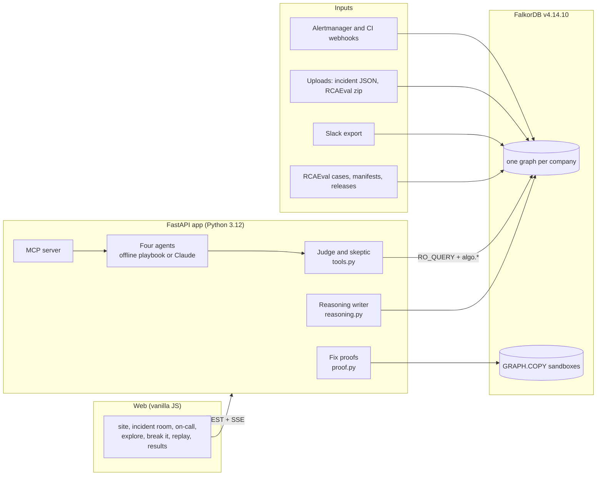

## Graph model


One FalkorDB graph per company. The seed writes the company (topology, people, changes, alerts, runtime, chat); the agents write their reasoning into the same graph as they work (orange below).

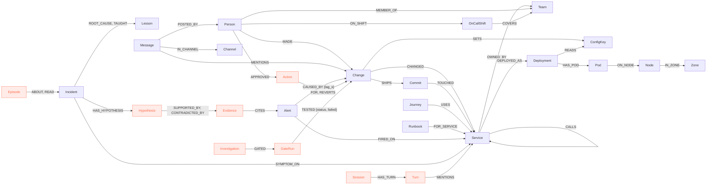

- **Every label, relationship type, property and count** is in [docs/graph-model.md](docs/graph-model.md), generated from freshly seeded graphs after the agents have run on every open incident. `tests/test_schema.py` regenerates it and fails if the file has drifted from what the code builds. Kestrel, after a run: 660 nodes, 1,506 relationships, 29 labels and 48 relationship types; 7 of the labels and 16 of the relationship types are written by the agents, not the seed.
- The real systems (Online Boutique, Sock Shop, Train Ticket) add the operation graph from their traces (`(:Service)-[:EXPOSES]->(:Operation)-[:CALLS]->(:Operation)`, with p50, p99 and error rates), log templates (`LogPattern`), and Online Boutique's releases (`Version`, `Image`).
- Indexes: full-text over `Lesson.text`, `Change.summary`, `Alert.signal`, `Incident.title` and `Message.text`; a vector index (18 dimensions, cosine) over `Incident.signature`; range indexes on every id.
- The reasoning is data: `MATCH p = (:Alert {id: 'A-9102'})-[:CAUSED_BY*]->(root) RETURN p` answers "why did this alert fire?" with A-9102 on mobile-bff ← A-9101 on auth ← D-5201.

## FalkorDB feature map


| Feature | Used for | Where |
|---|---|---|
| `algo.BFS` | everything a symptom depends on, with hop levels; the depth sweep | `tools.dependencies`, `tools.depth_sweep` |
| `algo.SSpaths` (`relDirection: 'incoming'`) | who a failure reaches; every suspect's footprint | `tools.callers`, `tools.blast_radius` |
| `algo.SPpaths` | the k shortest failure paths | `tools.failure_paths` |
| `algo.WCC` | alert groups, on a scratch graph of the alerting services | `tools.alert_clusters` |
| `algo.MSF` | how each problem spread, weighted by alert timing, on a scratch graph | `tools.spread_tree` |
| `algo.betweenness` | chokepoints (exact up to 500 services, sampled with a fixed seed above) | `tools.single_points_of_failure` |
| `algo.labelPropagation` | failure domains and the teams they reach | `tools.failure_domains` |
| `algo.pageRank` | criticality; node size | `tools.critical_services` |
| Vector index (`vecf32`, cosine) | past incidents with the same shape of story | `tools.similar_by_shape`, `tools.store_signature` |
| Full-text indexes | memory search over lessons, changes, alerts, incidents and chat | `tools.search_memory` |
| Variable-length paths | `CAUSED_BY*` "why did this alert fire", the alert chain over `CALLS*1..5` | `reasoning.why`, `tools.paths_between` |
| `GRAPH.COPY` | fix proofs, Break it, the load test, these tests | `proof.py`, `site.py`, `bench.py` |
| `GRAPH.RO_QUERY` | every read, so the database itself refuses writes there | `db.py` |
| ACL users | one read-only user per tenant: `GRAPH.RO_QUERY` on its own graph key only | `db.ensure_reader` |
| One graph per tenant | each company and each upload, isolated | `db.graph_name` |

## The graph does the work


`tests/test_load_bearing.py` takes each algorithm, changes exactly what it reads on a `GRAPH.COPY` of Kestrel, and checks that the decision it feeds changes with it. The real graph is never touched.

| Algorithm (tool) | Decision it feeds | One change on the copy → what flips |
|---|---|---|
| `algo.BFS` (`dependencies`) | which changes can be suspects at all: the judge's first step | nothing calls `auth` any more → INC-302's verdict moves from **D-5201** to **C-5101** |
| `algo.SSpaths`, incoming (`callers`) | blast radius, and every suspect's footprint in the fault simulator | cut `checkout → payments` → `payments-db`'s blast radius goes from **5 services to 1** |
| `algo.SPpaths` (`failure_paths`) | the failure path the verdict shows and cites | cut `payments → payments-db` → **no path**, so none is claimed |
| `algo.WCC` (`alert_clusters`) | how many separate problems; the skeptic fails a verdict that leaves one unexplained | join `auth` to `payments` → INC-302's **3 problems become 2** |
| `algo.MSF` (`spread_tree`) | how each problem spread, from alert timing | add `users → catalog` → INC-305's tree links **catalog to users** instead of to `api-gateway` |
| `algo.betweenness` (`single_points_of_failure`) | the chokepoint on the failure path | drop `checkout`'s outgoing calls → top chokepoint **checkout → api-gateway** |
| `algo.labelPropagation` (`failure_domains`) | which failure domains and teams the alerts reach | drop `api-gateway`'s calls → **4 domains become 6** |
| `algo.pageRank` (`critical_services`) | criticality, and node size in the UI | everything calls `sendgrid` → most critical **events-kafka → sendgrid** |

Taken out, at the level of outcomes:

| Taken out | What happens | Where it's measured |
|---|---|---|
| **FalkorDB** | No answer at all: an investigation fails on the connection. There is no other store to fall back to, and nothing is guessed. | `tests/test_load_bearing.py` |
| **The alert chain** (the order alerts climb the call path) | Planted-fault top-1 drops from 93.3% to 88.7%; deep faults from 100% to 83.3% | [Evaluation](#evaluation) |
| **Paths altogether** ("blame the nearest recent change") | 10.7% top-1, against the judge's 93.3% | [Evaluation](#evaluation) |
| **Depth beyond one hop** | Kestrel's open incidents: 5 of 5 right become 3 of 5, and INC-301 blames a victim with high confidence | [Results, depth](https://16-4-94-72.sslip.io/results#depth) |
| **Where things run** (pods on nodes) | A failing node becomes two "independent" service faults: every host scenario is wrong | [Evaluation](#evaluation) |
| **Memory of solved incidents** | The same 150 faults a second time: 97.3% with precedent, 95.3% without | [Evaluation](#evaluation) |
| **One edge or node, seven ways** | Each Break-it experiment moves the verdict: 7 of 7 | `/break` |
| **Any safeguard** | Each of 28 named breakages is caught by a test | `make mutants` |

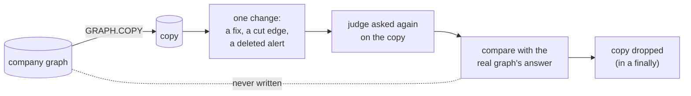

The same sandbox serves the fix proofs, Break it, the load test and the load-bearing tests above.

## Query catalogue


The queries the product depends on, as the code runs them (each step in the case file shows its own Cypher too).

| Question | Cypher | Where |
|---|---|---|
| What does the symptom depend on? | `MATCH (s:Service {name: $svc}) CALL algo.BFS(s, $hops, 'CALLS') YIELD nodes, edges` | `tools.dependencies` |
| Who does a failure reach? | `CALL algo.SSpaths({sourceNode: s, relTypes: ['CALLS'], relDirection: 'incoming', maxLen: 5, pathCount: 1000000}) YIELD path, pathWeight` | `tools.callers` |
| What changed on that path? | `MATCH (c:Change)-[:CHANGED]->(s:Service) WHERE s.name IN $svcs AND c.at >= $from AND c.at <= $to` | `tools.changes_near` |
| Every path from the symptom down to a suspect | `MATCH p = (a:Service {name: $a})-[:CALLS*1..5]->(b:Service {name: $b}) RETURN [n IN nodes(p) \| n.name] AS path` | `tools.paths_between` |
| The failure path | `CALL algo.SPpaths({sourceNode: a, targetNode: b, relTypes: ['CALLS'], maxLen: $max, pathCount: $k})` | `tools.failure_paths` |
| How many separate problems? | `CALL algo.WCC({nodeLabels: ['Service'], relationshipTypes: ['CALLS']}) YIELD node, componentId` (scratch graph) | `tools.alert_clusters` |
| How did each one spread? | `CALL algo.MSF({nodeLabels: ['Service'], relationshipTypes: ['CALLS'], weightAttribute: 'gap'}) YIELD nodes, edges` (scratch graph) | `tools.spread_tree` |
| Why did this alert fire? | `MATCH p = (a:Alert {id: $id})-[:CAUSED_BY*1..12]->(root) RETURN p` | `reasoning.why` |
| Where are the chokepoints? | `CALL algo.betweenness({nodeLabels: ['Service'], relationshipTypes: ['CALLS'], samplingSize: $k, samplingSeed: 1})` | `tools.single_points_of_failure` |
| Which incidents looked like this one? | `CALL db.idx.vector.queryNodes('Incident', 'signature', $k, vecf32($v)) YIELD node, score` | `tools.similar_by_shape` |
| What do we know about these words? | `CALL db.idx.fulltext.queryNodes('Message', $q) YIELD node, score` (and over lessons, changes, alerts, incidents) | `tools.search_memory` |
| Where did this change come from? | `MATCH (m:Message)-[:MENTIONS]->(x) WHERE (x:Service AND x.name = $svc OR x:Change AND x.id = $id) AND m.at >= $lo` plus the thread replies | `tools.decision_trail` |
| What would this fix clear? | `GRAPH.COPY`, then the alerts whose `CAUSED_BY` path ends at what the fix removes | `proof.preview_fix` |

## Results

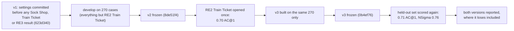

The charts above summarise it; the [Results page](https://16-4-94-72.sslip.io/results) has every table, read from the files that publish them, and runs the fix proofs live. Below: the planted-fault evaluation, then every RCAEval case against the published baselines.

## Evaluation


```bash
docker compose run --rm app python -m faultline.eval              # 150 scenarios, seed 7, ~3 s
docker compose run --rm app python -m faultline.eval --n 400 --seed 3
```

The eval plants faults on Kestrel's real topology, one incident per scenario, spaced so their windows never overlap: **deep** (a change 1–3 hops below the symptom, alerts climbing to it), **silent** (the same, but the cause never alerts), **infra** (nothing changed; a dependency failed), **shared** (a deep change that also breaks a second service, which opens its own incident) and **host** (nothing changed; a node degrades and two services it runs, which share no other node and don't call each other, fail together). Every scenario carries distractors: a change close to the symptom (sometimes newer than the cause, sometimes older) with no alerts below it, a change off the path, and an old low-risk change on it. Top-1 accuracy, seed 7:

| | deep (30) | silent (30) | infra (30) | shared (30) | host (30) | **all (150)** | top-3 all |
|---|---|---|---|---|---|---|---|
| **Hypocenter (judge)** | 100.0% | 73.3% | 100.0% | 100.0% | 93.3% | **93.3%** | 98.7% |
| **Hypocenter (judge + skeptic)** | 100.0% | 73.3% | 100.0% | 100.0% | 93.3% | **93.3%** | 98.7% |
| no recency | 100.0% | 50.0% | 100.0% | 100.0% | 93.3% | **88.7%** | 98.7% |
| no proximity | 100.0% | 73.3% | 100.0% | 100.0% | 93.3% | **93.3%** | 98.7% |
| no alert_chain | 83.3% | 70.0% | 100.0% | 96.7% | 93.3% | **88.7%** | 98.7% |
| no risk | 100.0% | 66.7% | 100.0% | 100.0% | 93.3% | **92.0%** | 98.7% |
| no precedent | 100.0% | 73.3% | 100.0% | 100.0% | 93.3% | **93.3%** | 98.7% |
| no footprint | 100.0% | 63.3% | 100.0% | 100.0% | 93.3% | **91.3%** | 98.7% |
| nearest recent change | 20.0% | 3.3% | 0.0% | 30.0% | 0.0% | **10.7%** | 60.0% |
| most recent change | 93.3% | 80.0% | 0.0% | 76.7% | 0.0% | **50.0%** | 60.0% |

When it says… **high** confidence (42 cases): right 100.0%; **medium** confidence (87 cases): right 95.4%; **low** confidence (21 cases): right 71.4%.

Linked incidents (shared scenarios): precision 1.0, recall 1.0.

Learning: the same 150 faults planted again after the first round was resolved: top-1 93.3% → 97.3%. Without the precedent factor the second round scores 95.3%.

Held-out seeds (400 scenarios each), judge → judge + skeptic: 94.2% → 94.5% (seed 3), 96.2% → 96.8% (seed 11), 96.2% → 96.5% (seed 42); top-3 99.8–100%; host faults 98.8–100%; linked-incident precision and recall 1.0. Confidence on the held-out seeds: **high** was right 99.2–100% of the time, **medium** 98.0–99.1%, **low** 74.6–83.8%. (Before the host kind existed the same seeds scored 95.8–97.5% on four kinds; adding a fifth reshuffles which faults each seed draws, and the silent ones, the weak spot, came out harder.)

Without host suspects (`_host_suspects` returning nothing) every host scenario is wrong by construction: the judge blames one of the two services and reports the other as an independent fault, which is what Hypocenter did before the runtime layer existed. The host kind is planted exactly as the rule expects, so its score says the mechanism works, not how often real nodes fail this cleanly.

How to read it honestly:
- The scenario generator is mine, so this measures the judge against the failure patterns it was designed for, not against real outages. The weights were adjusted while looking at seed 7; the held-out seeds are the fairer number.
- Risk labels are drawn at random for causes and distractors alike, so in this eval risk is noise and switching it off can help some kinds. In real change logs risky changes do break things more often.
- Precedent does nothing on a first sighting (memory is empty). Its effect is the learning row: the same faults again after round one was resolved.
- Silent causes are the weak spot (72–84% with the skeptic on the held-out seeds): with no alert of their own, a recent change one level up can still look better.
- Confidence is conservative: "medium" and "low" verdicts are right more often than the labels suggest. It is still ordered correctly (high > medium > low), which is what an on-call engineer needs to know when to double-check.

## Public data: every RCAEval case, against the published baselines


The synthetic eval measures the judge against the patterns it was built for. On real telemetry Hypocenter runs on **all of** [RCAEval](https://huggingface.co/datasets/phamquiluan/RCAEval)'s multi-source and code-level suites (MIT, [paper](https://arxiv.org/abs/2412.17015)): **360 recorded failures** in three systems, Online Boutique (12 services), Sock Shop (15) and Train Ticket (68). RE2 (270 cases) injects CPU, memory, disk, delay, packet loss and socket faults; RE3 (90 cases) plants bugs in the services' code. Every case comes with metrics, logs, traces where the system has them, and the true root-cause service.

It is scored the way RCAEval scores its own baselines, against **RCAEval's own implementations of those baselines, run here on the same cases** (`baselines/`, their package in its own image, never in Hypocenter's). Every ranking, Hypocenter's included, goes through RCAEval's service mapping and is scored with AC@1 and Avg@5 (the mean of AC@1…AC@5).

```bash
make eval          # everything: ~3.3 GB of RCAEval data, signals, Hypocenter, RCAEval's baselines, docs/rcaeval-results.md
make eval-quick    # with data, signals and baselines in place: re-score Hypocenter and rewrite the comparison (< 1 min)
```

The [Makefile](Makefile) spells out each step (download, extract, span profile, Hypocenter in both signal modes, the baselines in their own image, the comparison). Two runs give identical rankings.

**The harness reproduces the paper.** Our run of RCAEval's BARO on RE2 Train Ticket gives AC@1 0.47 / 0.93 / 1.0 / 0.60 / 0.47 / 0.53 per fault type and Avg@5 0.80, exactly the paper's Table 6. So the baselines below are run the way their authors run them.

**How the judge was developed, and what is held out.** Settings for every system were committed before any result on Sock Shop, Train Ticket or RE3 was seen (v1, commit `623d340`). v1 did badly away from Online Boutique: 155 of the 270 cases outside RE2 Train Ticket first, against 165 for "blame whatever alerted first" and 0.72 AC@1 for RCAEval's NSigma. Looking at those 270 cases, and only those, gave three changes (v2, commit `8de51f4`, frozen before the held-out run):

1. **The symptom service can be the cause.** RE3 plants code faults in Sock Shop's `front-end` itself; v1 never considered the entry point a suspect.
2. **Online Boutique's call graph = traces + its release manifests.** Spans miss calls into uninstrumented services (`adservice`, `shippingservice`, `cartservice` from frontend and checkout); the manifests' `*_ADDR` variables name them. Sock Shop's RE2/RE3 cases have no traces at all, so its graph comes from the project's code the same way (`faultline/rcaeval.py`). Train Ticket's comes from 1M+ spans per case, its untraced gateway, and each service's own database.
3. **Anomaly strength.** v1 used *when* each service alerted and nothing about *how much*. With the true graph, services that alert in every case (`redis`, `adservice`) competed with the cause. Now each silent-failure suspect's score blends in how many standard deviations its metrics moved (the n-sigma reading NSigma makes), relative to the strongest alert in the area. Weight 0.5, chosen on the 270 dev cases (0: 143/270 first, 0.5: 222, 1.0 i.e. strength alone on the graph's candidates: 220).

A third round (v3, commit `0b4ef76`) came out of the same 270 dev cases and nothing else: the ranking now continues past the judge's suspects (every other alerting service on the path by how far its metrics moved, then the quiet ones), and where there are traces, a *span profile* says whether a service's own work slowed or it only waited longer on something below it (`telemetry.span_profile`), blended in with weight 0.15 chosen on dev. Dev, AC@1 / AC@3 / Avg@5: v2 226 / 247 / 0.899, v3 228 / 247 / 0.907.

**RE2 Train Ticket was never looked at until v2 was frozen,** and was not used to build or tune v3 (it had been scored once, with v2). It is the held-out test, and the dataset the paper publishes numbers for:

| RE2 Train Ticket (90 held-out cases) | AC@1 | Avg@5 |
|---|---|---|
| **Hypocenter v3 (judge + skeptic)** | **0.71** | **0.75** |
| Hypocenter v2 | 0.70 | 0.75 |
| Hypocenter v1 (the pre-registered settings) | 0.29 | 0.58 |
| BARO (RCAEval's code, run here = published) | 0.67 | 0.80 |
| NSigma (RCAEval's code, run here) | 0.76 | 0.83 |
| TraceRCA (published) | 0.66 | 0.77 |
| Multi-source BARO (published) | 0.69 | 0.81 |
| PDiagnose (published) | 0.48 | 0.67 |
| CIRCA (published) | 0.32 | 0.46 |
| earliest alert | 0.16 | 0.49 |

**What that says.** On held-out data Hypocenter ranks first about as often as the best published methods (ahead of BARO and TraceRCA, behind NSigma), and its top five are worse than theirs (Avg@5 0.75 against 0.80–0.83): in 20 of the 26 Train Ticket misses the cause alerted but ranked below fifth among 68 services, which is where the next improvement has to come from (and it has to be found on other data). It is not the most accurate root-cause ranker on this benchmark, and this README does not claim it is. Where it differs is what comes with the answer: the path, the evidence for and against every suspect, the causal chain stored in the graph, the endpoint that slowed and the log lines that appeared, the owner, runbook and fix, and claims checked against the graph.

Every case (v3; 270 of the 360 were used to develop it, so read them as seen; CIRCA and PC-RandomWalk take 5–10 minutes per Train Ticket case here and were run on the other two systems):

| method | RE2-OB (90) | RE2-SS (90) | RE2-TT (90) | RE3-OB (30) | RE3-SS (30) | RE3-TT (30) | all |
|---|---|---|---|---|---|---|---|
| **Hypocenter v3, metrics** | 0.83 / 0.92 | 0.84 / 0.90 | 0.71 / 0.75 | 1.00 / 1.00 | 0.67 / 0.76 | 0.90 / 0.97 | **0.81 / 0.87** (360) |
| Hypocenter v2, metrics | 0.84 / 0.92 | 0.84 / 0.89 | 0.70 / 0.75 | 0.97 / 0.99 | 0.67 / 0.72 | 0.83 / 0.94 | 0.79 / 0.86 (360) |
| Hypocenter v3, + logs and traces as alerts | 0.69 / 0.89 | 0.83 / 0.89 | 0.74 / 0.78 | 1.00 / 1.00 | 0.33 / 0.66 | 0.90 / 0.96 | 0.75 / 0.86 (360) |
| NSigma | 0.79 / 0.91 | 0.86 / 0.94 | 0.76 / 0.83 | 0.83 / 0.89 | 0.57 / 0.83 | 0.80 / 0.96 | 0.78 / 0.90 (360) |
| CIRCA | 0.60 / 0.82 | 0.79 / 0.92 | – | 0.83 / 0.96 | 0.67 / 0.89 | – | 0.71 / 0.89 (240) |
| BARO | 0.14 / 0.74 | 0.07 / 0.76 | 0.67 / 0.80 | 0.00 / 0.77 | 0.00 / 0.74 | 0.77 / 0.95 | 0.28 / 0.78 (360) |
| PC-RandomWalk | 0.03 / 0.39 | 0.18 / 0.49 | – | 0.10 / 0.49 | 0.10 / 0.49 | – | 0.10 / 0.45 (240) |
| earliest alert | 0.80 / 0.94 | 0.59 / 0.89 | 0.16 / 0.49 | 0.77 / 0.95 | 0.43 / 0.64 | 0.23 / 0.42 | 0.51 / 0.75 (360) |

AC@1 / Avg@5. Full output with the paper's numbers alongside: [docs/rcaeval-results.md](docs/rcaeval-results.md).

**Logs and traces.** Every case's logs become templates (`faultline/telemetry.py`: ids, numbers, hex, ips and quoted strings masked, so 171k lines are ~500 patterns), and its spans an operation-level call graph with traffic and p50/p99 latency per call. Used as *alerts* (a service alerts when its error lines or span latency rise and stay up), they made the judge worse in v1 (133/270 against 155) and mixed in v2 (above), so the headline uses metric alerts, and logs and traces are used as **evidence**: each hypothesis cites the endpoint that slowed most (`(:Alert)-[:ON_OPERATION]->(:Operation)`) and the error log patterns that appeared with the incident (`(:LogPattern)-[:SEEN_IN]->(:Incident)`).

**Limits of the comparison.** Trace methods (MicroRank, TraceRCA) were not run here: RCAEval's `main.py` feeds every method metrics only, the span preparation behind their published numbers isn't in the repo, and our attempt did not reproduce them, so they are quoted as published. ε-Diagnosis needs Salesforce PyRCA and RCD Python 3.8; neither was set up. Hypocenter is given no injection time, but its detector, like every baseline, uses it to split normal from faulty data.

### The same failures, in the app: Online Boutique

`python -m faultline.rcaeval --fixture` boils all 54 cases down to a 130 KB fixture (`faultline/fixtures/boutique.json`): the call graph seen in the traces, and for each case the detector's alerts (time from the injection, peak z-score, and a 5-second z-score trace from 60 s before the fault to 4 minutes after) and RCAEval's answer key. No raw metrics or traces are kept. The seed turns it into a tenant:

- **36 solved incidents** (repetitions 1 and 2): `ROOT_CAUSE` on the true service, a verified fix (approver unknown: none is published), a lesson written from what the detector saw, and a shape vector each. This is the memory.
- **18 open incidents** (repetition 3), placed four hours apart so no two cases' alerts overlap. Their titles say only how many services alerted, never the metric that fired (a "socket" alarm on the frontend would give away a socket fault).
- **The answer key** goes to `world.py` only, so approving a fix is verified against what RCAEval says caused the case: paging the wrong team leaves the alerts firing.
- Owners come from the project's CODEOWNERS (one maintainers team for everything) and who knows each service from the last 200 commits to its `src/` directory, merged by name, bots kept apart (`python -m faultline.owners --fetch`, snapshot committed so the build stays offline).

With that memory and the weights learned from it, the judge + skeptic leads with the right service on **16 of the 18** open cases (16 in the top three; with the hand-set weights 15, and v1 on traced edges alone 15 with 17 in the top three). A test pins the number.

### Sock Shop and Train Ticket, in the app

The same treatment for the other two systems, every RE2 and RE3 case each (`python -m faultline.rcaeval` → `export_system`, fixtures in `faultline/fixtures/`): 120 incidents per company, repetition 3 of every fault open for the agents (27 and 26) and the rest solved history. Train Ticket's graph is **3,990 nodes and 5,265 edges**: 68 services, 160 operations with 203 operation-level calls carrying traffic and latency, 3,072 alerts, 397 hot-endpoint links and 287 error log patterns. Service cards list each service's endpoints (busiest first, with what each calls downstream) and the error logs it printed in past incidents. On the open cases, with weights learned from each company's solved incidents, the judge + skeptic leads with the right service on **21 of 27** (Sock Shop, 24 in the top three) and **19 of 26** (Train Ticket, 23 in the top three; the judge alone 21). Nobody's owners or on-call are public for these two, so each has a single owning team and no people.

## In detail

<details><summary>Seventeen things it does, in detail</summary>

1. **The alert chain decides, not proximity.** In INC-301 a `cart` deploy is one hop from the failing `checkout` and more recent than the real cause. Nothing on its path alerted, so it scores 0.27. A connection-pool change two hops down, on `payments-db`, has `payments-db`, `payments` and `checkout` alerting in that order above it, so it scores 0.94.
2. **"Nothing changed" is a first-class answer.** When no change on the path explains an incident, alerting dependencies with no change compete as suspects. In INC-303 the answer is "the search cluster failed first; this is infrastructure, page its owner", instead of blaming whatever deployed last.
3. **One change, many incidents.** Two teams often open separate incidents for one cause. Hypocenter checks whether the leading change also fully explains other open incidents (same alert-chain test), says so, and proposes one fix that covers all of them. One approval mitigates every linked incident. INC-301 (checkout) and INC-304 (refunds) are both the same pool change.
4. **Memory changes the score, not just the display.** Resolving an incident writes `ROOT_CAUSE`, `RESOLVED_BY` and a `Lesson` into the graph, and the next investigation scores precedent from them. A test deletes the memory and checks that the same change then scores lower.
5. **A fault simulator checks every suspect.** For each one it asks "if this broke, which services would alert, and in what order?" and compares that with what actually alerted: "explains 3 of 3 alerting services, in the predicted order". Alerts the leader can't explain point to **independent faults**: in INC-302 the auth deploy explains 2 of the 7 alerting services under `mobile-bff`, and Hypocenter names the other two faults behind the rest (the pool change of INC-301/304, the search cluster of INC-303). A cause that never alerts itself (a queue, a database) still counts when everything above it did, and a change the failure climbed *past* is marked down.
6. **Four agents, one graph, and a skeptic among them.** Triage, Investigator, Skeptic and Responder never pass anything to each other in code: each writes an `Episode` to the graph and the next one starts by reading it back, so an investigation can be resumed by another process or session. The **Skeptic** tries to knock the leader over before anyone acts: what doesn't it explain, did its alerts come in the right order, did the change land before the incident, is it clearly ahead? If a rival explains more and scores within reach, the verdict is overturned. Confidence comes from the **gap** to the runner-up, not the raw score. Verdicts stay in the graph as scored `SUSPECTED_CAUSE` and `SIMILAR_TO` edges, and the Responder attaches the team's `Runbook`.
7. **Measured, not claimed.** An eval plants hundreds of random faults on the same topology and reports accuracy, the drop when each factor is switched off, and two naive baselines (see [Evaluation](#evaluation)): 94.5–96.8% top-1 and 99.8–100% top-3 on held-out seeds, against 50% for "blame the most recent change". When Hypocenter says **high** confidence it has been right 99.2–100% of the time. On **real telemetry** it runs on every RCAEval RE2 and RE3 case (360 failures in three systems) against RCAEval's own baseline code, run here on the same cases: 0.81 first over all 360 (NSigma 0.78), 0.71 on the 90 Train Ticket cases kept out of development, ahead of BARO (0.67) and behind NSigma (0.76), with a worse top five than both (see [Public data](#public-data-every-rcaeval-case-against-the-published-baselines)). All 360 failures are loaded into the app as three more companies.
8. **Every claim is checked, every number is explained, and the agent can't act alone.** Every change id, incident id, service and clock time in a verdict is looked up in the graph, and what the claim *says* must match it ("C-5101 changed auth" fails: it changed payments-db; "D-5102 caused it" fails: it was ruled out; "payments alerted before payments-db" fails: the times say otherwise). The verdict must also hang together (the blamed change exists, changed the named service, and is among the judge's top suspects); claims Claude makes that the graph can't back are dropped from the evidence and shown as such. Each suspect shows its factor scores, its footprint and its path, and every step shows its Cypher. Free-form queries run through `GRAPH.RO_QUERY`, so the database itself refuses writes. The agent and the MCP server can only propose fixes; there is no approve tool.
9. **The reasoning is a subgraph you can query.** Every suspect becomes a `Hypothesis` (standing, overturned or rejected) with `Evidence` for and against it, and each piece of evidence `CITES` the alerts, changes and past incidents it rests on. The skeptic's checks run against *every* hypothesis, so a rejected one says why it lost ("leaves auth unexplained; 0.33 behind D-5201"). For the hypothesis left standing, the alerts are linked into a **causal chain**: `(:Alert)-[:CAUSED_BY {lag_s, confidence}]->(:Alert)…->(:Change)`. The topology decides which links are possible and the alert timing picks among them, naming silent hops ("via api") and ending at the change, or at the service that failed on its own. One query answers "why did this alert fire?": `MATCH p = (:Alert {id: 'A-9102'})-[:CAUSED_BY*]->(root) RETURN p` gives A-9102 on mobile-bff ← A-9101 on auth ← D-5201.
10. **It knows where things run.** Every service has its `Deployment` (replicas, CPU and memory limits, image and tag, the config keys, ConfigMaps and Secrets it reads), from the projects' real Kubernetes manifests for Online Boutique, Sock Shop and Train Ticket (secret values never kept), and pods scheduled onto `Node`s in `Zone`s for Kestrel. Two things follow. When two services that don't call each other fail on their own within minutes, and share one node, the judge names the **node** (INC-305: `catalog` and `users` on `k8s-node-4`; without placement it reports two independent faults). And a CPU or memory alert cites the limit the manifest sets ("checkoutservice is capped at 0.2 CPU"). A config change points at the `ConfigKey` it sets and every deployment that reads it.
11. **From deploy to commit.** Every Kestrel deploy `SHIPS` the commits behind it, and the investigator asks which one to read first: the commit that changed the most request-path code (docs, tests and dependency files don't count) and shares the most words with what the incident shows. For D-5201 that is "validate tokens against the rotating JWKS cache", not the runbook or the tests, and the argument cites the `Commit`. Online Boutique's last eight real releases are in its graph (`Version`-[:INCLUDES]->`Commit`, files and lines changed per service, the manifests' images `BUILT_FROM` v0.10.7), and the Company tab shows each team's deploys per week, change failure rate, time to restore and lead time, computed from the graph.
12. **It learns from its own outcomes, and from you.** On any hypothesis a person can say **not the cause** (it drops out of that incident at once, with their reason in the argument) or **confirm** it; both are kept as `Feedback` nodes. Each real company's judge is also refitted on its own solved incidents: every silent-failure suspect of every solved incident is a training row (its factors plus a **track record**: how often that service turned out to be the cause when it alerted, never counting the incident being scored), labelled by the cause the incident was closed with, people's verdicts included. A logistic regression is fitted and used only if, cross-validated over the solved incidents alone, it names the cause at least as often as the hand-set weights; the open incidents stay a clean test:

    | open incidents (not used to fit or decide) | hand weights | learned | Brier, hand → learned |
    |---|---|---|---|
    | Online Boutique (18) | 15 | 16 | 0.144 → 0.079 |
    | Sock Shop (27) | 21 | 22 | 0.105 → 0.082 |
    | Train Ticket (26) | 21 | 21 | 0.096 → 0.075 |

    Small gains in top-1 and clearly better calibration: when the learned model says 0.9 it is right about 0.9 of the time (the Memory tab shows the calibration bins). Services that alert in every incident and are rarely the cause (Online Boutique's `redis`) get a low track record and stop crowding the top. One cost found and not hidden: on Train Ticket the skeptic, whose takeover margin was set for hand scores, overturns four learned leaders and brings 21 down to 19. The RCAEval numbers above are the judge without any history (each case is its own graph); this is what history adds.
13. **Impact in customers' terms, and who was on call then.** `Journey` nodes say what a customer does and which services it needs. Train Ticket's 14 and Online Boutique's 11 come from the traces (each request entering the system and everything its calls reach; a client span that names an uninstrumented service, like `hipstershop.CartService/GetCart`, adds it and its datastore), with no SLO invented. Kestrel's six carry SLOs, so a case file says "checkout: 38 of 43.2 minutes of its 30-day error budget gone", and the Company tab keeps a 30-day budget per journey that charges an incident only to journeys needing the service the failure was *in*, not where it was noticed. A weekly on-call rota (`OnCallShift`) answers who was on call when it started, not just now.
14. **Watch it work, and replay what happened.** Running the agents streams each tool call to the case file as it happens (server-sent events, `GET …/investigate/stream`): which agent, what it did, how many queries and milliseconds in FalkorDB. The offline playbook finishes in well under a second, so the page asks the server to space steps out (`pace_ms`, at most 500); it waits between real steps, nothing is replayed. Under the graph a scrubber replays the incident: drag or press play and changes land (dashed), services start alerting and each causal hop appears with its lag, minute by minute.
15. **Other companies' outages as precedent, without taking their words.** `python -m faultline.public_postmortems --fetch` reads [Dan Luu's list of public post-mortems](https://github.com/danluu/post-mortems) (about 240 write-ups, each a link to the company's own report) into a local `knowledge` graph, `(:PublicPostmortem)-[:IN_CLASS]->(:FailureClass)`. A case file then lists the public outages that look like its leading explanation: same failure class (a config change → config errors, a failing node → hardware), at least two shared words, with the link and the words that matched. The list has no licence, so nothing from it is in this repository; the importer only fetches it on your machine, and a test checks the fixtures stay clean. Precedent only, never scored.
16. **It holds up at size.** `python -m faultline.scale` builds a synthetic company of 1,000 or 3,000 services (five operations each, deployments and pods on nodes, 90 days of changes and alerts, ~200 planted incidents) and times every query the agents use ([docs/scale.md](docs/scale.md)). At 3,000 services, **211,000 nodes and 252,000 edges**: the judge answers in 73 ms (p50), judge + skeptic + WCC in 78 ms, 5-hop dependency walks (algo.BFS) in about a millisecond, PageRank in 16 ms, and it names the planted change first in 197 of 198 incidents. The benchmark also found a limit: exact betweenness ran FalkorDB out of memory at 3,000 services, so above 500 services `single_points_of_failure` now samples 500 sources with a fixed seed (approximate, marked as such, 393 ms).
17. **Graph algorithms do real work in the investigation, all eight that FalkorDB v4.14.10 ships:** BFS walks down from the symptom to everything it depends on, SSpaths walks up to everyone a failure would hurt, WCC splits the alerts into separate problems, MSF shows how each one spread, SPpaths traces the failure path, betweenness flags chokepoints on it, label propagation names the failure domains and teams, PageRank ranks criticality. See [the table](#falkordb-feature-map).

Built for **Graph Hacks: Context for AI Agents** (WeMakeDevs × FalkorDB, Oct 15–18 2026).
Tracks: **01 Agents That Act on Connected Data** (main), **02 Agent Memory and Coordination**, **03 Company Brain**.

Kestrel Pay and Harbor Freight are synthetic, Kestrel's chat included. **Online Boutique, Sock Shop and Train Ticket** are real: every failure in the public RCAEval benchmark's RE2 and RE3 suites (call graphs, metrics, logs, operation-level traces, root causes), with Online Boutique's owners and contributors from its own CODEOWNERS and git history. Nothing outside the graph is ever changed.

</details>

## Memory, company brain and chat


- **Episodic:** every resolved incident with its root cause, fix and lesson; every investigation and handoff; every conversation turn.
- **Semantic:** owners (CODEOWNERS and commit history for Online Boutique), who actually knows a service from what they did, runbooks, journeys and SLOs, where every service runs.
- **Procedural:** each kind of fix's track record on each service, counted from whether the alerts cleared.
- **Chat:** channels, threads and what each message mentions, loaded from a Slack export (Kestrel's is synthetic). The investigator reads what was said around an incident; "why was C-5101 made?" returns the proposal, the approval and the warning, from before it landed. Chat is context, never scored: a test deletes it and the verdict is identical.
- **Conversations:** each question in the Ask bar is a `Turn` in a `Session`, so "who owns it?" knows what "it" was.
- **Searchable:** full-text over lessons, changes, alerts, incidents and chat; past incidents matched by the shape of their story through a vector index.

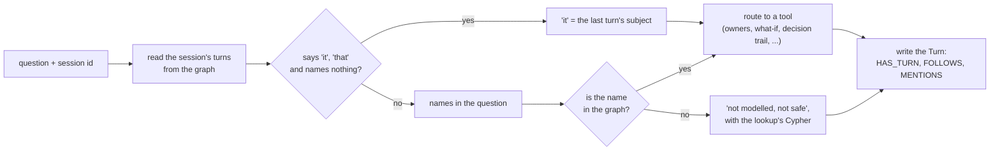

## On-call


The rota is in the graph: `(:Person)-[:ON_SHIFT]->(:OnCallShift {from, to})-[:COVERS]->(:Team)`. For every open incident the judge names a suspect, the page goes to whoever is on call for the team that owns it now, and the case file also shows who was on call when it started. The On-call page has a pager inbox with acknowledgements, everyone on call now and next, and time to restore. The responder also names the failure domains and teams the alerts reach (label propagation).

## Learns from the people who use it


- On any hypothesis a person can say **not the cause** (it drops out of that incident at once, with their reason in the argument) or **confirm** it. Both are kept as `Feedback` nodes.
- Each real company's judge is refitted on its own solved incidents (people's verdicts included) and the refit is used only if cross-validation on the solved incidents says it is at least as good; the open incidents stay a clean test.
- Precedent changes the score: the same 150 planted faults a second time score 97.3% with memory of the first round, 93.3% the first time.

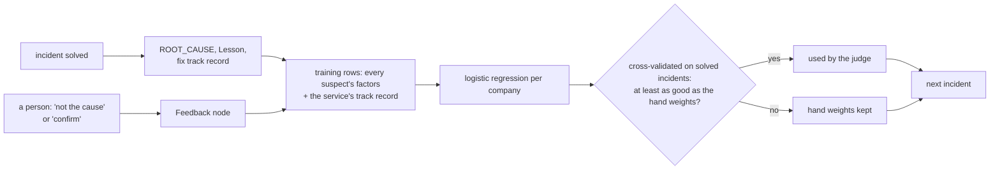

## Agents and actions

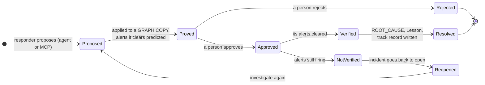


- **Four agents.** *Triage* reads the incident, its dependencies, recent changes and alerts. *Investigator* reads triage's handoff from the graph, runs the judge and the fault simulator, and checks precedent. *Skeptic* reads the investigator's handoff and challenges the leader (deterministic checks, up to two rounds, may overturn). *Responder* reads the skeptic's verdict, finds the owner and the runbook, and proposes the fix. Each writes an `Episode` that the next reads back (`(:Episode)-[:READ]->(:Episode)`); nothing is passed in memory.
- **The argument is written to the graph.** The Skeptic calls `record_argument` (every hypothesis, its evidence for and against, and the causal chain), and the Responder starts by following the symptom's alert down its `CAUSED_BY` links with `why`. Both are also MCP tools, and the case file shows the argument and the chain before anything is written (the preview is read-only).
- **Claude** (`claude-opus-5-5`, adaptive thinking) plays each role with only that role's tools. The **offline playbook** runs the same roles and tools in a fixed order, so the demo works without a key. Both return the same steps, labelled by agent, with the Cypher behind each.
- **Fix track record** (procedural memory): for each kind of fix on each service, how often it worked and how often it didn't, counted at read time from executed `Action`s and whether `verify_fix` saw the alerts clear, never kept as counters. The Memory tab lists it; the responder cites it ("revert_config on payments-db worked 1 of 1 time before (INC-212)") and warns when a fix has failed there before. Kestrel's history includes two first attempts that didn't work (rolling back `payments` during INC-212, `cart` during INC-197); a failed fix is never recorded as what resolved an incident.
- **Load test in the app**: Memory tab → 10 / 25 / 50 investigations, 8 at a time, on a `GRAPH.COPY` of the tenant (deleted afterwards). It shows investigations per second, p50/p95, and the two checks that matter: **isolation** (no run read another run's handoffs) and **consistency** (every run reached the same verdict as a run on its own). One at a time server-wide.
- **Memory**: every investigation is stored as an `Investigation` node. The next run on the same incident starts by reading it. Resolving an incident writes `ROOT_CAUSE`, `RESOLVED_BY` and a `Lesson`, which feed the precedent factor of the next investigation. The Memory tab shows what the agent has learned.
- **Actions**: the agent can only propose (`rollback`, `revert_config`, `disable_flag`, `page_owner`). A person approves in the UI. Approval writes a remediation change to the graph and marks the incident mitigated. It is a simulation: no real system is touched. Re-running an investigation never stacks duplicate proposals.
- **Memory you can search and match**: every resolved incident gets an 18-number *signature* of its story (kind of cause, kind of thing that broke, depth below the symptom, tiers, risk) stored in a FalkorDB **vector index**, so `shape_matches` finds past incidents that looked the same on other services (INC-212's pool change matches INC-230's Kafka retention change at 0.91). Shape matches are shown as evidence but not scored: crediting them helped look-alike decoys as much as real causes in the eval. **Full-text indexes** over lessons, changes, alerts and incident titles back `search_memory` ("pgbouncer pool connections" finds INC-212's lesson, its pool change, today's C-5101 and the payments-db alert). `experts(service)` ranks people by what they did: fixes they approved for incidents caused there, changes they made, owning team.
- **Concurrency** (`python -m faultline.bench`): copies the demo graph with `GRAPH.COPY` and runs many investigations at once. 40 runs, 8 at a time: about 80 runs a second, no handoff ever read from another run, every run complete, every verdict identical to a single run. Queries retry with backoff when FalkorDB reports it is busy; errors in a query are never retried.
- **Proof before approval**: every proposed fix is first applied to a `GRAPH.COPY` of the company's graph with the causal chain written in; the alerts whose `CAUSED_BY` path ends at what the fix removes are cleared there and the judge is asked again, so the card says what the fix will clear, what it will leave and what explains the rest (`faultline/proof.py`). The copy is dropped; the prediction stays on the `Action`.
- **Verification**: approving a fix is not the end. The fix is applied to a simulated system (`faultline/world.py`, which stands in for production and is the only place the true cause of each alert is written down), and monitoring reports which alerts recover. Hypocenter then verifies from the graph alone: every alert in each covered incident's alert cone must have cleared after the fix. If any is still firing, the fix is marked as not working and the incident reopens. Approving the pool revert clears INC-301 and INC-304 and nothing else; approving a rollback of the unrelated `cart` deploy leaves checkout, payments and payments-db firing and reopens INC-301. A test checks that no agent tool or MCP tool imports the simulator's answer key.
- **Tenants**: one FalkorDB graph per company (`hypocenter_kestrel`, `hypocenter_boutique`, `hypocenter_harbor`, and `hypocenter_up_…` per upload). Isolation comes from separate graphs, not a property filter, and a test proves it.

## Before it ships: the pre-deploy check

The same graph, read before an outage instead of after one. Pick a service and a kind of change (on the **Ship it?** page, `/preflight`, through the `preflight_change` MCP tool, or from CI) and Hypocenter answers **ship**, **review** or **hold**, each reason with what it rests on:

- **Hold** when an open incident runs through the service: its leading suspect is a change on it, or it is one of the services alerting in it. A deploy on `auth` during INC-302 is held: D-5201 on auth is the suspect, roll that back first.
- **Review** when a change like this one caused an incident on the service before (with the lesson: INC-188, "token validation changes need a canary on mobile-bff traffic"), when changes already landed on it in the last two hours, when undoing that kind of change there has failed before, or when it is central: a top-five PageRank service with internet-facing callers, or a top-five betweenness chokepoint (`notifications`).
- **Ship** otherwise, still with what would feel it: the callers in the waves the alerts would arrive in (`algo.SSpaths`), the user journeys and their SLOs, the teams that would be paged and who is on call, and who to ask for review (the people who fixed or changed the service before).

It reads only. From CI, before merge: `scripts/preflight.sh auth deploy "switch JWT validation to a rotating JWKS cache"` prints the reasons and exits 1 on hold (`STRICT=1` also fails on review); the route is `POST /api/{tenant}/preflight`.

## Context for any agent (MCP)


The same tools are available to any MCP client:

```bash
docker compose exec -T app python -m faultline.mcp_server          # stdio
```

Claude Code: `claude mcp add hypocenter -- docker compose -f /path/to/faultline/docker-compose.yml exec -T app python -m faultline.mcp_server`

On a public server (`docker-compose.public.yml`) the same tools are served over streamable HTTP at `https://<host>/mcp`, read-only: `propose_action` is not registered there.

Two tools are meant for agents working before and after the fact: `evidence_gate` (is the leader proven, and if not, why not) and `preflight_change` (ship, review or hold, for a coding agent about to open a pull request). Over stdio the server reads as the tenant's own read-only database user. A plain-text map of the repository for agents is in [llms.txt](llms.txt).

There is deliberately no approve tool. An agent can propose a fix; only a person can run it.

## Running it in detail

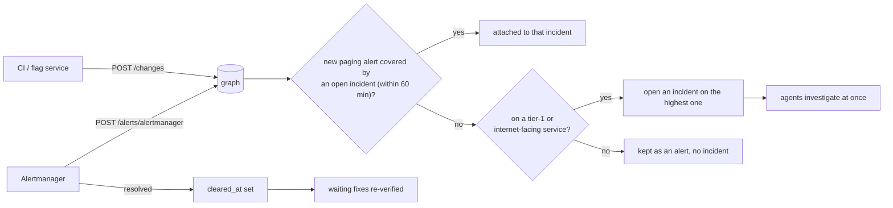


```bash
docker compose up -d --build
```

- Overview: http://localhost:8090 · incident room: http://localhost:8090/app
- On-call `/oncall` (who to page for each open incident, from the rota in the graph) · Explore `/explore` (the whole
  graph, every label) · Break it `/break` (seven one-line changes, each judged on a `GRAPH.COPY`) · Replay
  `/replay` (an investigation streamed live, then played back step by step)
- FalkorDB browser: http://localhost:3003 (graph `hypocenter_kestrel`)
- Tests: `docker compose run --rm app pytest -q`
- **For a judge: `make judge-check`** (about 2 minutes, Docker only, no key). It builds and starts everything, runs every test, then checks the product itself on scratch graphs it drops afterwards: the agents' verdict on each Kestrel incident, depth 1 against full depth, a question about something not in the graph, the fix proofs, the Break-it experiments, the planted-fault eval against this README's number, and isolation under concurrent runs. The output of a run on a fresh clone is in [docs/judge-check-clean-clone.txt](docs/judge-check-clean-clone.txt).
- **The README's images** come from the running app: `node demo/screens.mjs docs/img` for the screenshots, `node demo/gif.mjs` then `bash demo/gif.sh` for the GIF (both need `playwright-core`).
- **`make live-run`** (needs `ANTHROPIC_API_KEY`, spends tokens): the four agents played by Claude on INC-302, on scratch graphs, written down as a transcript: every tool each agent chose, the findings, which claims the graph backed, and whether the model agreed with the judge.
- **`make mutants`** breaks each safeguard on purpose, one at a time, on a scratch copy of the code, and checks a test notices: the depth limit, the "not in the graph" answer, the alert-order rule, the skeptic, the claim checks, fix verification, the read-only guards, tenant ids, the answer key staying out of the judge, the public-server guards, graph copies being dropped, the follow-up memory, chat mentions, each agent's tool list, dropping claims the graph can't back, treating no path as safe, ignoring a rival that passes the same checks, and tenant reads bypassing their read-only user. **28 of 28 caught** ([docs/mutants.txt](docs/mutants.txt)).

The graphs are built on first start. **Reset** in the header rebuilds them. **Guided demo** (or http://localhost:8090/app?demo=1) plays the whole story on the live app with captions.

### The app

- **Answer first.** Opening an incident shows the case file at once: the verdict, confidence, how many of its claims were checked against the graph, and the one-paragraph story. It is the judge and the skeptic reading the graph directly (about 70 read-only queries, ~20 ms); nothing is written. **Run the four agents** re-derives it step by step, records the handoffs in the graph and proposes the fix. Their steps sit folded under *Agent handoffs*, each with its Cypher.
- **Case file sections:** root cause (path, change, spread, what it explains, fix, owners, score), **blast radius** (one block per service the failure reaches: the path to it, internet-facing or not, owning team and on-call, alerting now or quiet), proposed fixes with approve and verify, a **timeline** of every alert and change in the window (real metric traces as sparklines on Online Boutique), the skeptic's checks, alert groups (WCC), other faults, memory and precedent, evidence, and every suspect with its factor bars.
- **Focused graph.** With a case open, the canvas shows only what the case touches (the symptom, the top suspects' paths, everything alerting, the callers the cause reaches) and lays it out again; *Whole system* puts everything back. *replay traversal* walks the failure path again.
- **Risk board** (every incident, open first by severity, with the suspect the judge leads with and its confidence), **Memory** (solved incidents, lessons, full-text search over them) and **Company** (teams and on-call, chokepoints by betweenness, failure domains by label propagation, and a card per service: owners, who actually knows it, callers, recent changes, past incidents, runbooks, and the queries behind the card). Click any node on the graph to open its card.
- **Command bar** (ctrl k): an incident id opens it; anything else is a question for the graph, answered with the tool calls and queries behind it.
- The header shows FalkorDB's live node and edge counts, the test count and the two eval numbers, and turns red with a banner if the database goes away. Light and dark themes follow the OS; the ◐ button overrides it.
- **Export postmortem** on any case file: Markdown built only from the graph (summary, root cause with author and lag, how we know, a timeline, impact, the fix and its verification, linked incidents, the lesson, similar past incidents, and the Cypher behind it). A draft until the incident is resolved.

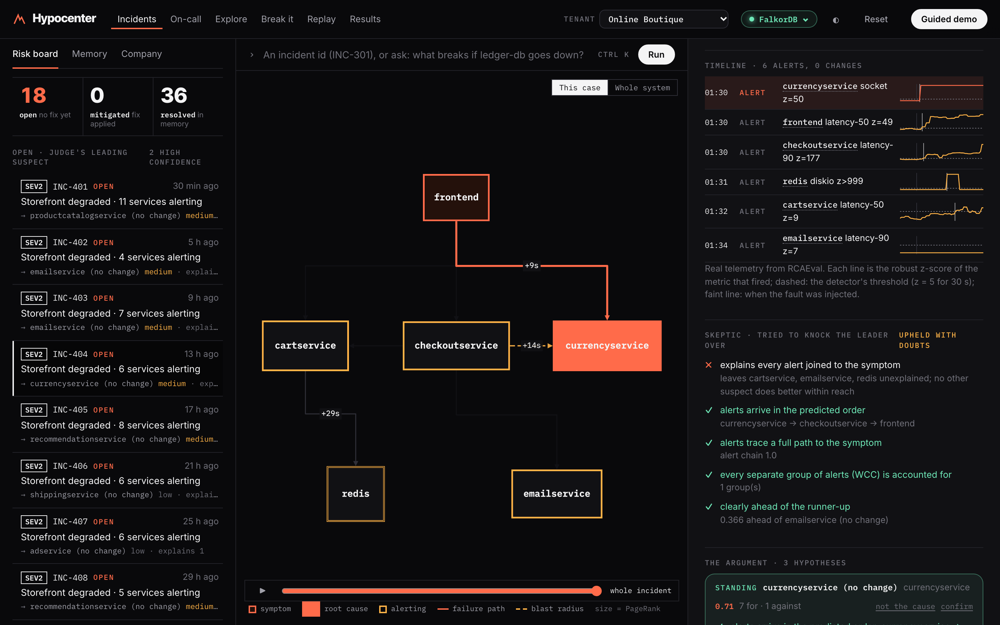

### Live input: monitoring and CI push, Hypocenter acts

```bash
demo/fire.sh            # CI posts a fraud-scoring deploy, Alertmanager posts three alerts climbing to checkout
demo/fire.sh resolve    # the same alerts, resolved: an approved fix is verified by real recovery
```

- `POST /api/{tenant}/changes`: a deploy, config or flag change from CI/CD (`{kind, service, summary, at, author, version, ...}`).
- `POST /api/{tenant}/alerts/alertmanager`: Alertmanager's webhook body (Grafana alerting sends the same). Alerts are idempotent on their fingerprint; unknown services are reported back, not fatal; bodies over 1 MB are refused.
- **Opening rule** (`faultline/ingest.py`): a paging alert on a tier-1 or internet-facing service opens an incident unless an unresolved one already covers that service (it is the symptom or below it) within an hour. The symptom is the paging service with the most new alerts below it. The four agents investigate at once, and the response names the cause: the `fire.sh` run opens INC-501 and blames `D-6001` with high confidence, and the responder adds that rolling back `fraud-scoring` worked the one time it was tried (INC-221).
- An approved fix on a live incident is not simulated: it waits for monitoring, and the resolved alerts verify it. One investigation per incident at a time (a second gets 409).

### Bring your own incident

On the start panel, or `POST /api/upload`: a JSON file in Hypocenter's format ([web/examples/incident.json](web/examples/incident.json): services, calls or spans, people, changes, alerts, the incident), or one case zipped in RCAEval's layout (`inject_time.txt`, metrics and traces as parquet or CSV, read with the same detector as the benchmark). Each upload becomes its own graph (`up_…`) and the judge reads it at once; the example's answer is `C-102`, a connection limit cut two hops below the storefront. Uploads are capped (2 MB JSON, 40 MB zip, 400 MB unzipped), names and counts validated, zip members read by name only (no paths), one at a time, and only the 8 newest are kept. A trace export has no deploys in it, so its answers are always "nothing changed" infrastructure suspects.

To let Claude drive the investigation instead of the offline playbook, put a key in `.env` before starting:

```bash
echo "ANTHROPIC_API_KEY=sk-ant-..." > .env
docker compose up -d
```

Without a key, a fixed playbook calls the same graph tools in the same order, so the demo always works. The header shows which mode is running.

**Demo video:** `demo/` regenerates it from the running app. Put one voiceover MP3 per scene of `demo/narration.json` in `data/demo/audio/` (with a `durations.txt` of `<scene> <seconds>` lines), then run `node demo/record.mjs data/demo/audio data/demo/rec` (needs `playwright-core@1.64.1`) to record the real UI in time with the voice, and `demo/mix.py` in any container with ffmpeg to lay in the audio, burn in captions and write `data/demo/hypocenter-demo.mp4`.

## Safety


- **The agent can only propose.** There is no approve tool, for the agents or over MCP. A person approves every fix; nothing outside the simulated world is changed.
- **Reads can't write.** Every read goes through `GRAPH.RO_QUERY`; the free-form Cypher tool also refuses write keywords.
- **One read-only database user per tenant.** A request for a company reads as that company's own FalkorDB ACL user (`GRAPH.RO_QUERY` on its one graph key, nothing else), made at first use with a random per-process password that is never written down. A write, or another tenant's graph, is refused by the database itself. Scratch graphs and writes use the shared connection; `FAULTLINE_TENANT_ACL=0` turns it off, and a server that won't create users falls back and says so in the FalkorDB menu.
- **No path is not safe.** A failure the graph can't link to the symptom is reported as "not proven, check the topology", not ruled out, and keeps the verdict from being called confirmed.
- **Public mode:** webhooks need a token, the routes that do work are rate-limited, and the public MCP endpoint is read-only.
- **The answer key stays out.** The simulator that knows the true causes (`world.py`) is never imported by the judge or the agents; a test checks it.
- **Tenants are separate graphs**, and tenant ids are validated so one can't reach another's.
- **Copies are dropped.** Fix proofs, Break-it experiments and the load test run on `GRAPH.COPY`s that are deleted afterwards.
- **Data:** only public, synthetic or our own; secret values in the projects' manifests are never kept; the public post-mortem list has no licence, so it is fetched on your machine and never committed.
- How to report a vulnerability, and every guard with the file it lives in: [SECURITY.md](SECURITY.md). Keyboard, screen-reader and motion support, and what isn't covered yet: [ACCESSIBILITY.md](ACCESSIBILITY.md).
- Most of these are among the 28 breakages `make mutants` checks a test catches ([docs/mutants.txt](docs/mutants.txt)).

## What's real vs synthetic


| | Real | Synthetic |
|---|---|---|
| **Failures and telemetry** | Online Boutique, Sock Shop, Train Ticket: every RCAEval RE2 and RE3 case (metrics, logs, traces, root causes) | Kestrel Pay and Harbor Freight: changes, alerts, incidents |
| **Topology** | the three systems' call graphs from their traces, and their Kubernetes manifests | Kestrel's 24 services, pods and nodes |
| **People** | Online Boutique's owners and contributors from CODEOWNERS and git history | Kestrel's teams, rota and chat |
| **Releases** | Online Boutique's last eight releases and their commits | Kestrel's deploys and commits |
| **Fixes** | | applied to a simulated system that reports which alerts recover |

## Scope and assumptions


- Kestrel's changes and alerts are synthetic. Online Boutique's are real but recorded; its owners and contributors are real, but it has no on-call rota or approval history, so none is shown. The RCAEval runner shows the path for real data (graph from traces, alerts from metrics), but there is no live ingestion: a real deployment would also read deploys, config and flags from CI/CD and the flag service.
- The anomaly detector is deliberately simple (a sustained robust z-score). It raised an alert on the true root-cause service in all 360 RCAEval cases, but it has no change-point or slow-leak detection.
- The clock is frozen at 14:00 UTC on 17 Oct 2026, so every run tells the same story.
- The base scoring weights are hand-set and explained in the UI; each real company's refit is used only when cross-validation on its solved incidents says it is at least as good. The eval shows what each factor contributes.
- The fault simulator models the call graph only. It does not know fault types (CPU, memory, network) or traffic volume, which would sharpen the predicted footprint.
- The tests reach the Claude path through a scripted transport, not the live API; the eval and the demo use the offline playbook. `make live-run` is the live check, and it spends tokens.

## What didn't work


- **The skeptic against learned scores.** Its takeover margin was set for hand-weighted scores; on Train Ticket it overturns four learned leaders and brings 21 right down to 19. Left in, reported above.
- **Exact betweenness at 3,000 services** ran FalkorDB out of memory. Above 500 services it now samples 500 sources with a fixed seed, and says it is approximate. Reproduced on its own afterwards: on v4.14.10 the memory grows with every node in the graph times the sample size, not with the labelled subgraph (3,000 services beside 150,000 unrelated nodes OOM a 6 GB container; alone they need 334 MB). The script is `scripts/betweenness-memory-repro.sh`, with a draft issue for FalkorDB in [docs/upstream](docs/upstream/falkordb-betweenness-memory.md).
- **Crediting look-alike incidents** (vector shape matches) helped decoys as much as real causes in the eval, so shape matches are shown as evidence and never scored.
- **Train Ticket, held out:** NSigma beats Hypocenter on AC@1 (0.76 against 0.71) and on Avg@5. v3 was built on the other 270 cases only, so this stays the honest number.
- **The mutation suite's first run caught 19 of 21.** No test noticed if the judge stopped marking down a change the failure had already climbed past, or if a verdict called an off-path change the cause. Both now have tests, and both breakages are caught.
- **The first claim checker** only checked that ids and times existed. Fed three false claims about INC-301, it accepted all three; it now checks what each claim says.

## AI disclosure


Rule 11 asks for it.

- **How it was built.** Claude Code (Anthropic) was the coding assistant and wrote most of the code, tests and docs. The author chose the problem and the tracks, the rules the agent works under (the alert chain decides, "nothing changed" is an answer, the agent can only propose, a person approves), what data to use and what to leave out (the post-mortem list has no licence, so it is never committed), and approved every push.
- **How the output was checked rather than trusted.** The test suite runs against a real FalkorDB (`docker compose run --rm app pytest -q`), and the safeguards are checked by breaking the code on purpose: `make mutants` runs 28 named breakages and a test catches every one. The planted-fault eval has ablations and naive baselines; the RCAEval comparison runs RCAEval's own baseline code, with Train Ticket held out until the method was frozen. Numbers on the site and in the Results page are read from the files that publish them, and tests tie them together; the numbers in this README are tagged with their source and checked by `make claims`.
- **The product's own model use.** With `ANTHROPIC_API_KEY` set, `claude-opus-5-5` plays the four agents with only each role's tools. Without it, the offline playbook calls the same tools in a fixed order. The verdict comes from the deterministic judge either way. The Claude path is tested end to end through the real Anthropic SDK with a scripted transport (`tests/test_claude_path.py`: the request each role sends, its tool list, the handoffs, the dropped claims), and `make live-run` runs it against the API with your key and writes the transcript to `docs/live-run-<incident>.md`. Until that file is in the repository, the live API has not been called from here.
- **Media.** The demo video is recorded from the running app by `demo/film.mjs` and mixed by `demo/mix2.py`. Its narration is a synthetic AI voice (text-to-speech, no one's voice cloned) reading `demo/narration.json`, with generated sound effects; the captions are the same script.

## Repo map


```
faultline/db.py          FalkorDB access, per-tenant graphs, query trace, read-only guard
faultline/seed.py        the synthetic companies (deterministic)
faultline/tools.py       graph tools, the judge, the evidence gate, actions, memory
faultline/preflight.py   the pre-deploy check: ship, review or hold before a change goes out
faultline/claims.py      `make claims`: every number tagged in the README against the file that measured it
faultline/public_postmortems.py  imports the public post-mortem list locally (never committed); matches incidents to it
faultline/scale.py       scale benchmark: 1,000-3,000 synthetic services, query latencies, judge accuracy
faultline/learn.py       weights fitted on a company's solved incidents and people's verdicts; cross-validated, calibrated
faultline/delivery.py    releases, commits and the deploy→commit links (fixtures/boutique_releases.json: real)
faultline/manifests.py   the three systems' real Kubernetes manifests, boiled down (fixtures/manifests.json)
faultline/proof.py       proves a fix on a GRAPH.COPY before approval: what it clears, what it leaves, and why
faultline/reasoning.py   the argument as a subgraph: hypotheses, evidence, citations, the CAUSED_BY chain
faultline/agent.py       the four agents (Claude or offline playbook), the case preview + question router
faultline/eval.py        planted-fault accuracy eval with ablations, baselines and a learning run
faultline/rcaeval.py     RCAEval runner for all three systems: topology, alerts, strength, AC@k and Avg@5
faultline/telemetry.py   logs → templates and error-log alerts; spans → operation graph and span alerts
faultline/compare.py     Hypocenter against RCAEval's baselines on the same cases
baselines/               RCAEval's own baseline code in its own image, and the runner that mirrors its main.py
faultline/bench.py       concurrency benchmark: many investigations at once on a graph copy, isolation checked
faultline/world.py       the simulated system: true causes, and which alerts a fix clears (agents never read it)
faultline/mcp_server.py  MCP server over the same tools
faultline/api.py         FastAPI: case file, board, company, service cards, memory search + the static UI
faultline/fixtures/      boutique.json / sockshop.json / trainticket.json: RCAEval cases boiled down (MIT, see rcaeval.py);
                         boutique_owners.json: CODEOWNERS + per-service commit history (owners.py --fetch)
faultline/ingest.py      live input: CI change events, the Alertmanager webhook, the incident opening rule
faultline/upload.py      bring your own incident: JSON or an RCAEval-layout zip, validated, as a new tenant
faultline/postmortem.py  Markdown postmortem from the graph
faultline/judge_check.py the product checks behind `make judge-check` (scripts/judge-check.sh), on scratch graphs
faultline/mutants.py     `make mutants`: 28 safeguards broken one at a time on a scratch copy; a test must catch each
faultline/live_run.py    `make live-run`: the Claude agents on one incident, written down as a transcript
faultline/chat.py        chat in the graph: a Slack export (or Kestrel's synthetic chat) as channels, messages, threads, mentions
faultline/owners.py      fetches Online Boutique's real owners and commit history from GitHub
deploy/                  public deployment: Caddy (HTTPS) + docker-compose.public.yml, see DEPLOY.md
demo/fire.sh             plays a live incident in through the webhooks
scripts/preflight.sh     the pre-deploy check from CI: exit 1 on hold
llms.txt                 the repository, mapped for agents
web/index.html           the page: header, three tabs, command bar, graph, case file
web/js/                  ES modules, no build step: util, parts (shared HTML), graph (Cytoscape: whole
                         system / this case), casefile, board, memory, company, ask (command bar), tour, main
tests/                   pytest against a real FalkorDB, on separate test graphs
```

## License

Apache License 2.0: see [LICENSE](LICENSE). Data derived from RCAEval (MIT) and from Online Boutique, Sock Shop and Train Ticket (Apache 2.0) is credited in [NOTICE](NOTICE).
